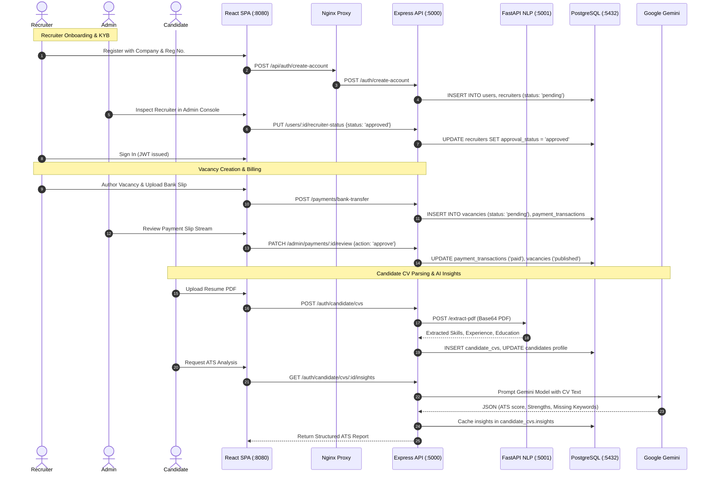
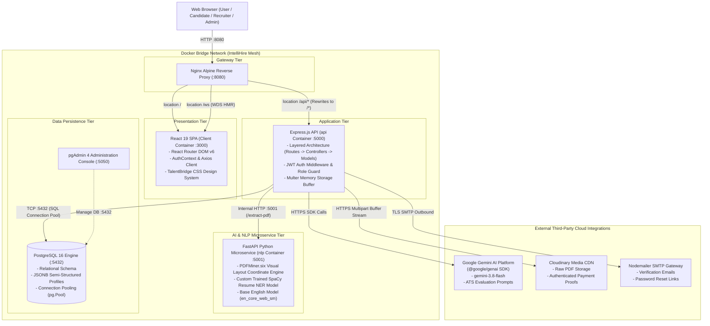
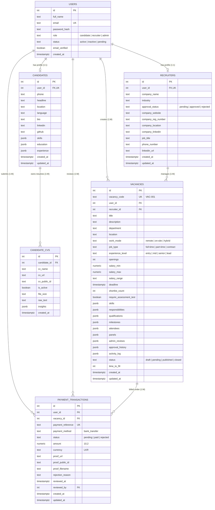

# INTELLIHIRE – TECHNICAL DOCUMENTATION & VIVA PREPARATION REPORT
**Smart Recruitment and Career Preparation System**

---

## Executive Summary & Metadata
- **Project Name:** IntelliHire – Smart Recruitment and Career Preparation System
- **Repository Path:** `d:\intellihire\Source-code`
- **Confirmed Active Technologies:**
  - **Frontend:** React 19 (`19.2.7`), React Router DOM v6 (`6.20.0`), Axios (`1.6.0`), Lucide React (`1.25.0`), Tailwind CSS v3 (`3.4.19`), Vanilla CSS Design System (TalentBridge design tokens).
  - **Backend API:** Node.js (CommonJS), Express.js (`4.16.3`), `pg` (`8.0.3` Node-Postgres connection pool), `multer` (`2.2.0`), `jsonwebtoken` (`9.0.3`), Node.js native `crypto` (`scryptSync`, `randomBytes`, `randomUUID`), `cloudinary` (`2.10.0`), `pdf-parse` (`1.1.1`), `nodemailer` (`6.9.13`), `@google/genai` (`2.27.0`).
  - **NLP Microservice:** Python 3.10+, FastAPI (`0.103.1`), Uvicorn (`0.23.2`), Pydantic v2 (`2.3.0`), spaCy (`3.6.1`) with `en_core_web_sm` and Custom Trained Resume NER (`resume_ner_model`), `pdfminer.six` (`20260107`), `python-multipart`.
  - **Database & Administration:** PostgreSQL 16 (relational schema with JSONB dynamic attributes), pgAdmin 4.
  - **Gateway & Reverse Proxy:** Nginx Alpine (Unified single entry-point reverse proxy on port 8080 with path rewriting).
  - **Containerization & Orchestration:** Docker, Docker Compose (6 interconnected services: `client`, `api`, `nlp`, `postgres`, `pgadmin`, `nginx`).
  - **Testing Frameworks:** Playwright Test (`1.64.1`) for End-to-End browser testing; React Testing Library (`16.3.2`) + Jest for frontend unit/integration testing.
- **Overall Architecture Summary:** Containerized multi-tier microservices/modular monolith architecture coordinated through an Nginx reverse proxy. The system separates interactive user UI (React SPA), API and database transactions (Express + PostgreSQL), heavy PDF layout parsing and NLP entity extraction (FastAPI + spaCy), and Generative AI ATS analysis (Google Gemini API).
- **Major Modules Identified:**
  1. Authentication, Authorization & User Management (Candidate, Recruiter, Admin RBAC)
  2. Candidate Profile & Multi-CV Document Management
  3. Hybrid CV Extraction Pipeline (PDFMiner layout + spaCy NER + Node fallback)
  4. AI CV ATS Insights & Conversational CV Assistant (Google Gemini SDK)
  5. Recruiter Company Verification & KYB Workflow (Admin review)
  6. Vacancy Lifecycle Management (Draft, Published, Closed)
  7. Recruiter Subscription & Payment Slip Verification (Cloudinary authenticated proof + Admin workflow)
  8. Recruiter Candidate Ranking & Applicant Pipeline (Frontend Rich Mock Simulation)
  9. Interview Scheduling, Time-Slot Allocation & Google Calendar/Meet Generator (Client-side / localStorage)
  10. Candidate AI Mock Interview Simulator (Frontend interactive simulation)
  11. Candidate Technical Assessments & Question Bank (Frontend mock state)
  12. Peer Community Forum (Frontend + localStorage state)
- **Features Confirmed Implemented (Full Stack & Database):**
  - User registration with validation, scrypt password hashing, and role assignment (`users`, `candidates`, `recruiters`).
  - Recruiter KYB company details submission and administrative approval gate (`recruiters.approval_status`).
  - JWT token generation, verification middleware, and RBAC enforcement.
  - Dual CV upload pipeline: Local multipart storage + Cloudinary remote raw storage.
  - Multi-tier CV extraction: FastAPI layout-aware PDF parser -> spaCy NER -> Node pdf-parse -> regex fallback.
  - Candidate multi-CV management: upload, set active, replace, stream download, and delete.
  - AI ATS analysis with Gemini (`@google/genai`), structured JSON extraction, caching in `candidate_cvs.insights`, and chat grounding.
  - Vacancy creation, sequential code generation (`VAC-001`), database listing, search, filtering, update, and closing.
  - Bank-transfer payment slip submission, authenticated Cloudinary storage, transaction logging, admin review, and automated vacancy publishing.
  - Comprehensive Playwright end-to-end test suite testing real database states and UI flows.
- **Features Incomplete, Client-Side Mocked, or Planned:**
  - Candidate Ranking & Scoring Engine: Implemented as rich frontend mock data (`MOCK_CANDIDATES`) and client-side scoring logic (`enrichCandidateDetails`); no backend ranking endpoint or database candidate-to-vacancy matching table exists.
  - Recruiter Interview Time-Slot Management & Panel Allocation: Stored in browser `localStorage` via `interviewService.js`; Google Calendar and Google Meet integrations are client-side URL parameter generators, not backend OAuth2 API integrations.
  - AI Mock Interview Simulation: Interactive UI with countdown timer and audio recording UI, but questions and evaluation scores (e.g., 84%) are simulated in React state; no Gemini endpoint or database table persists mock interview sessions.
  - Technical Assessments & Question Bank: Rendered using local mock datasets; no PostgreSQL schema or backend routes exist for test submissions.
  - Email Verification: The backend database schema contains `email_verified`, but it is hardcoded to default to `true` at registration, and the verification route explicitly bypasses verification to facilitate testing and development.
  - Legacy/Unused Code: Stephen Grider multi-docker starter boilerplate (`/values`, `numbers` table query) remains in `valuesRoutes.js`, `valuesController.js`, and `valueModel.js`.

---

# 1. Project Overview

### 1.1 Purpose of IntelliHire
IntelliHire is an enterprise recruitment automation and career preparation platform designed to modernize the traditional hiring pipeline. It bridges the gap between job candidates seeking career progression and talent acquisition teams looking for qualified professionals. The system automates resume ingestion, structured profile creation, ATS optimization, and hiring management.

### 1.2 Problems It Aims to Solve
1. **Manual CV Screening Overhead:** HR teams spend hours manually parsing varied PDF resume formats. IntelliHire implements visual coordinate parsing and Named Entity Recognition (NER) to extract structured fields automatically.
2. **Resume Formatting & ATS Inefficiencies:** Candidates struggle to understand why their resumes fail automated Applicant Tracking Systems. IntelliHire provides instant ATS scoring, keyword gap analysis, and tailored CV optimization suggestions powered by Google Gemini AI.
3. **Unverified Recruiters & Fraudulent Job Postings:** Many recruitment boards suffer from scam vacancies. IntelliHire introduces an administrative Know-Your-Business (KYB) verification workflow where recruiters must provide corporate registration and receive admin approval before posting.
4. **Disorganized Interview Coordination:** Coordinating multi-round interviews between candidates and panel members is prone to schedule conflicts. IntelliHire organizes time-slot management, panelist assignments, and calendar integration.
5. **Candidate Interview Anxiety:** Candidates often lack domain-targeted practice before real interviews. IntelliHire provides a simulated AI mock interview suite with role-specific technical and behavioral questions.

### 1.3 Target Users and Roles
The platform defines three primary authenticated roles enforced through database constraints and JWT claims, plus an auxiliary panelist view:
- **Candidate (`role: 'candidate'`):** Job seekers who create profiles, upload multiple CVs, inspect AI ATS feedback, search vacancies, apply to jobs, practice mock interviews, and participate in community discussions.
- **Recruiter (`role: 'recruiter'`):** Corporate talent acquisition professionals who register company credentials, await admin verification, purchase posting allowances via bank transfers, create and publish vacancies, review applicant pipelines, allocate interview slots, and evaluate candidates.
- **System Administrator (`role: 'admin'`):** Privileged operators who inspect registered users, approve or reject recruiter business credentials, review submitted bank transfer slips, audit system actions, and oversee platform activity.
- **Interview Panelist (Specialized Recruiter Sub-view):** Technical or HR interviewers assigned to evaluate candidates during designated interview time slots.

### 1.4 Main Features and Modules
1. **Authentication & Identity Management:** JWT-based session security, role-based redirection, password hashing, and session timeout management.
2. **Candidate Profile & Document Repository:** Multi-CV storage with active CV toggling, Cloudinary raw asset streaming, and automatic CV-to-profile database synchronization.
3. **AI CV Insights & Career Coach:** Deep LLM analysis assessing ATS compatibility, strengths, weaknesses, missing skills, and interactive CV chat.
4. **NLP Document Extraction Microservice:** High-performance PDFMiner and spaCy Named Entity Recognition engine extracting contact info, work history, education, and technical competencies.
5. **Recruiter Onboarding & KYB Verification:** Administrative verification workflow gating recruiter access until business legitimacy is confirmed.
6. **Vacancy Lifecycle & Publishing Engine:** Multi-step vacancy authoring, sequential `VAC-xxx` code generation, and search/filter listing.
7. **Payment Verification & Billing Gateway:** Bank transfer slip upload, private Cloudinary asset streaming, transaction reconciliation, and automated vacancy activation.
8. **Candidate Ranking & Shortlisting Interface:** Visual applicant pipeline with score breakdowns, skill match percentages, and status workflows.
9. **Interview Scheduling & Calendar Dispatcher:** Interactive slot management, panel assignment, reschedule handling, and Google Calendar / Google Meet deep-linking.
10. **AI Mock Interview Simulator:** Timed practice interface with question navigation, category tags, answer drafting, and performance scoring.
11. **Skill Assessment & Question Bank:** Quiz and coding test builder with candidate score reports.
12. **Community Forum:** Peer-to-peer discussion board with guideline enforcement and bookmarking.

### 1.5 Overall Application Workflow


### 1.6 Distinction: Implemented vs. Planned/Client-Side Functionality
| System Module | Implementation Level | Verification Evidence in Repository |
|---|---|---|
| User Authentication & RBAC | **Fully Implemented** | `authController.js`, `authMiddleware.js`, `roleMiddleware.js`, `userModel.js` |
| Recruiter KYB Verification | **Fully Implemented** | `recruiters` table, `adminRoutes.js`, `VerifyRecruiters.jsx` |
| CV Upload & Cloudinary Storage | **Fully Implemented** | `uploadMiddleware.js`, `cloudinaryService.js`, `candidate_cvs` table |
| Multi-tier NLP CV Extraction | **Fully Implemented** | `nlp/main.py`, `train_ner.py`, `nlpService.js`, `pdfParser.js` |
| Gemini AI ATS Insights & Chat | **Fully Implemented** | `geminiService.js`, `authController.js` (`getCVInsights`, `chatWithCV`) |
| Vacancy CRUD & Sequential Codes | **Fully Implemented** | `vacancies` table, `vacancyModel.js`, `vacancyController.js` |
| Bank Transfer Proof & Admin Review | **Fully Implemented** | `payment_transactions` table, `paymentController.js`, `adminPaymentController.js` |
| Playwright E2E Test Suite | **Fully Implemented** | `e2e/tests/`, `playwright.config.js`, `api.js` helpers |
| Candidate Ranking & Scoring | **Partially Implemented (UI Mock)** | `RankedApplicants.jsx` uses `MOCK_CANDIDATES` and frontend `enrichCandidateDetails` |
| Interview Scheduling & Allocation | **Partially Implemented (localStorage)** | `interviewService.js` persists in browser `localStorage`; no backend routes |
| Google Calendar / Meet Integration | **Partially Implemented (URL Deep-Link)** | Deep-link template generators; no OAuth or Google Calendar API SDK |
| AI Mock Interview Simulator | **Partially Implemented (UI Simulation)** | `MockInterviewSession.jsx` timer and UI; hardcoded questions and static 84 score |
| Technical Assessments / Tests | **Partially Implemented (UI Mock)** | `AssessmentsPage.jsx`, `TakeAssessmentPage.jsx` rely on local mock datasets |
| Community Discussion Forum | **Partially Implemented (localStorage)** | `CommunityPage.jsx` stores posts in browser `localStorage` |

---

# 2. Project Structure

### 2.1 Complete Repository Directory Map
```text
d:\intellihire\Source-code/
├── backend/                       # Node.js / Express REST API Application
│   ├── src/
│   │   ├── config/                # Database pool connection, migrations & admin seeder
│   │   │   ├── cloudinary.js      # Cloudinary v2 SDK initialization
│   │   │   ├── db.js              # PostgreSQL client connection pool & auto-migrations
│   │   │   └── seedAdmin.js       # Startup account seeder (Admin, Candidate, Recruiter)
│   │   ├── controllers/           # HTTP Request Handlers & Business Orchestration
│   │   │   ├── adminPaymentController.js # Admin payment listing, review, proof streaming
│   │   │   ├── authController.js  # Registration, login, password, CV CRUD, Gemini chat
│   │   │   ├── candidateController.js # Candidate profile retrieval & updates
│   │   │   ├── cvController.js    # Local disk CV upload & NLP extraction test route
│   │   │   ├── paymentController.js # Recruiter bank transfer slip submission & status
│   │   │   ├── vacancyController.js # Vacancy creation, listing, querying, updating, closing
│   │   │   └── valuesController.js  # Boilerplate starter controller (legacy)
│   │   ├── middlewares/           # Express Route Middlewares
│   │   │   ├── authMiddleware.js  # JWT Bearer token decoding & validation
│   │   │   ├── errorHandler.js    # Global error handling middleware
│   │   │   ├── roleMiddleware.js  # Role-Based Access Control (RBAC) guard
│   │   │   └── uploadMiddleware.js # Multer in-memory PDF filter & size validation
│   │   ├── models/                # PostgreSQL Data Access Layer & Parameterized Queries
│   │   │   ├── candidateModel.js  # CRUD for candidates profile & candidate_cvs records
│   │   │   ├── paymentModel.js    # Queries for payment_transactions joined with vacancies
│   │   │   ├── recruiterModel.js  # Queries for recruiters table & approval updates
│   │   │   ├── userModel.js       # Queries for users table (auth, status, passwords)
│   │   │   ├── vacancyModel.js    # Complex SQL for vacancies, filters, search, VAC codes
│   │   │   └── valueModel.js      # Legacy starter model
│   │   ├── routes/                # Route Endpoint Definitions & Middleware Binding
│   │   │   ├── adminRoutes.js     # /users, /users/:id/recruiter-status, /admin/payments
│   │   │   ├── authRoutes.js      # /auth/create-account, /auth/login, /auth/candidate/cvs
│   │   │   ├── candidateRoutes.js # /candidate/profile
│   │   │   ├── cvRoutes.js        # /cv/upload (disk storage route)
│   │   │   ├── paymentRoutes.js   # /payments/bank-transfer, /payments/:reference
│   │   │   ├── vacancyRoutes.js   # /vacancies, /vacancies/:id, /vacancies/:id/close
│   │   │   └── valuesRoutes.js    # /values (legacy)
│   │   ├── services/              # External Integrations & Service Layer
│   │   │   ├── cloudinaryService.js # Cloudinary upload buffer, delete, signed private URLs
│   │   │   ├── cvTextService.js   # In-process pdf-parse buffer & URL text extractors
│   │   │   ├── geminiService.js   # Google Gemini AI ATS insights & CV chat assistant
│   │   │   ├── mailService.js     # Nodemailer SMTP email dispatcher (verification/reset)
│   │   │   ├── nlpService.js      # Microservice client for FastAPI NLP + regex fallback
│   │   │   └── tokenService.js    # JWT signing and verification with secret key
│   │   ├── utils/                 # Utility Helper Functions
│   │   │   ├── password.js        # Node.js crypto scryptSync password hashing & verification
│   │   │   ├── pdfParser.js       # pdf-parse wrapper for binary text extraction
│   │   │   ├── response.js        # Standardized API response wrappers (success/error)
│   │   │   └── verificationToken.js # Random token generation utilities
│   │   ├── app.js                 # Express application configuration & router registration
│   │   └── server.js              # Server entry point: DB initialization -> seeder -> listen
│   ├── .env                       # Environment configuration (DB, JWT, Gemini, SMTP, Cloudinary)
│   ├── Dockerfile.dev             # Docker image definition for backend development
│   ├── index.js                   # Root forwarding script to src/server.js
│   ├── key.js                     # Environment variable binding object
│   └── package.json               # Backend dependencies and startup scripts
│
├── frontend/                      # React 19 Client Single Page Application
│   ├── public/                    # Static Web Public Assets
│   │   ├── index.html             # HTML5 template mount point (#root)
│   │   └── manifest.json          # Web application manifest
│   ├── src/
│   │   ├── __tests__/             # Unit and component integration tests (Jest / RTL)
│   │   │   ├── communityModerationSuite.test.js
│   │   │   └── userListingSuite.test.js
│   │   ├── api/                   # Axios API Client Modules
│   │   │   ├── apiInstance.js     # Base Axios instance, Bearer token injection, 401 interceptor
│   │   │   ├── authApi.js         # API calls for auth, passwords, CVs, insights, and chat
│   │   │   ├── paymentApi.js      # API calls for bank transfer submission and admin review
│   │   │   ├── userApi.js         # API calls for admin user management and profile
│   │   │   └── vacancyApi.js      # API calls for vacancy CRUD and closing
│   │   ├── components/            # Reusable UI Presentation Components
│   │   │   ├── common/            # Shared layouts, sidebars, badges, modals
│   │   │   │   ├── AdminSidebar.jsx
│   │   │   │   ├── DropdownMenu.jsx
│   │   │   │   ├── InsightPanel.jsx
│   │   │   │   ├── RecruiterSidebar.jsx
│   │   │   │   ├── StatusBadge.jsx
│   │   │   │   └── VacancySelectorModal.jsx
│   │   │   └── TopBar/            # Universal dashboard header navigation bar
│   │   ├── context/               # React Context State Providers
│   │   │   └── AuthContext.js     # Global session state, user role, inactivity watchdog
│   │   ├── data/                  # Static Mock Datasets
│   │   │   ├── applicants.js      # Mock applicant pool
│   │   │   └── vacancies.js       # Mock vacancy listings
│   │   ├── pages/                 # Role-Specific View Pages
│   │   │   ├── admin/             # System Administration Views
│   │   │   │   ├── AdminProfile/
│   │   │   │   ├── Dashboard/     # Platform health metrics & quick links
│   │   │   │   ├── ManageUsers/   # User role and status management table
│   │   │   │   ├── ModerateCommunity/ # Community post moderation
│   │   │   │   ├── MonitorSystem/ # Service telemetry simulation
│   │   │   │   ├── Payments/      # Bank transfer slip review and approval
│   │   │   │   ├── VerifyRecruiters/ # KYB business approval console
│   │   │   │   └── ViewAuditLogs/ # Security event logs
│   │   │   ├── candidate/         # Job Seeker Views
│   │   │   │   ├── ApplicationDetails/
│   │   │   │   ├── Assessments/   # Take assessment & results pages
│   │   │   │   ├── CandidateDashboard/ # Main candidate layout wrapper
│   │   │   │   ├── CVInsights/    # Interactive AI ATS score, keywords, CV chat
│   │   │   │   ├── DashboardPage/ # Candidate overview widget dashboard
│   │   │   │   ├── jobs/          # Job search, job detail, application confirmation
│   │   │   │   ├── MockInterview/ # AI interview simulator (roles, questions, session, feedback)
│   │   │   │   ├── MyApplications/ # Applied job tracker
│   │   │   │   ├── Profile/       # Candidate profile editor & multi-CV manager
│   │   │   │   ├── Settings/      # Password change & notifications
│   │   │   │   ├── SignIn/        # Candidate & general sign-in
│   │   │   │   ├── Signup/        # Candidate registration with CV dropzone
│   │   │   │   └── VerifyEmail/   # Email verification landing page
│   │   │   ├── community/         # Peer discussion forum & guidelines
│   │   │   ├── landingpage/       # Public marketing landing page
│   │   │   ├── panel/             # Interview Panelist Schedule View
│   │   │   └── recruiter/         # Talent Acquisition Views
│   │   │       ├── Analytics/     # Funnel, applicant & shortlisting analytics
│   │   │       ├── Assessments/   # Assessment builder & question bank
│   │   │       ├── BankTransfer/  # Slip upload form
│   │   │       ├── CreateVacancy/ # 4-step wizard for vacancy posting
│   │   │       ├── Dashboard/     # Recruiter metrics & candidate pipeline
│   │   │       ├── InterviewAllocation/ # Candidate-to-interviewer slot allocator
│   │   │       ├── InterviewTimeSlotManagement/ # Interview calendar & slot builder
│   │   │       ├── PaymentBilling/ # Subscription plans & billing status
│   │   │       ├── PreviewVacancy/ # Vacancy preview before checkout
│   │   │       ├── RankedApplicants/ # AI ranked candidate list & match breakdown
│   │   │       ├── RecruiterProfile/ # Company profile manager
│   │   │       ├── Signup/        # Recruiter KYB registration form
│   │   │       └── VacancyManagement/ # List of active/draft vacancies
│   │   ├── routes/                # Client-Side Routing
│   │   │   ├── AppRoutes.js       # Complete route table & role redirects
│   │   │   └── ProtectedRoute.js  # Authentication and RBAC route wrapper
│   │   ├── services/              # Client Data Services
│   │   │   ├── adminStorage.js    # LocalStorage admin state utilities
│   │   │   ├── interviewService.js # LocalStorage interview slot & reschedule store
│   │   │   └── storage.js         # JWT & session persistence (remember device logic)
│   │   ├── styles/                # Global Theme Stylesheets
│   │   │   └── admin.css          # Dark chrome admin theme variables
│   │   ├── App.js                 # App root with AuthProvider and AppRoutes
│   │   ├── index.js               # React 19 createRoot DOM bootstrap
│   │   └── style.css              # TalentBridge global CSS variables and reset
│   ├── Dockerfile.dev             # Docker image definition for frontend development
│   └── package.json               # Frontend dependencies and build scripts
│
├── nlp/                           # Python FastAPI AI / NLP Microservice
│   ├── models/                    # Serialized Machine Learning Models
│   │   └── resume_ner_model/      # Custom trained spaCy 3.6 NER pipeline
│   ├── main.py                    # FastAPI application, layout parser, entity extraction
│   ├── requirements.txt           # Python library requirements
│   ├── train_ner.py               # Model training script for custom CV NER entities
│   ├── training_data.py           # Annotated CV training datasets (7 custom labels)
│   └── Dockerfile                 # Python 3.10 container with en_core_web_sm
│
├── nginx/                         # High-Performance Reverse Proxy
│   ├── default.conf               # Unified routing rules & WebSocket upgrade headers
│   └── Dockerfile.dev             # Alpine Nginx container definition
│
├── e2e/                           # Playwright End-to-End Test Suite
│   ├── tests/
│   │   ├── auth/                  # Login, candidate signup, recruiter KYB signup
│   │   ├── candidate/             # Candidate profile editing, CV insights & chat tests
│   │   ├── helpers/               # api.js direct REST helpers for setup and teardown
│   │   └── recruiter/             # Recruiter profile and vacancy management tests
│   ├── playwright.config.js       # Playwright runner configuration (Chrome, workers: 1)
│   └── package.json               # E2E dependencies (@playwright/test)
│
├── docker-compose.yml             # Container Orchestration Specification
├── package.json                   # Root package containing E2E test convenience scripts
├── system_design.md               # Visual design system guidelines & CSS token specs
└── README.md                      # Platform technical readme and developer guide
```

---

# 3. System Architecture

### 3.1 Overall Architectural Patterns
The application follows a **containerized, service-oriented multi-tier architecture** with an edge reverse proxy gateway. While the core business logic resides in an Express.js modular monolith, computationally intensive text processing is decoupled into an asynchronous Python microservice, and generative intelligence is delegated to an external LLM provider.

1. **API Gateway Pattern:** Nginx acts as the single point of ingress on port `8080`. Frontend clients never communicate directly with internal container ports (`3000`, `5000`, `5001`, `5432`).
2. **Layered (N-Tier) Backend Pattern:** Inside `backend/src`, execution flows cleanly through distinct architectural layers:
   `Routes` $\rightarrow$ `Middlewares` $\rightarrow$ `Controllers` $\rightarrow$ `Services` $\rightarrow$ `Models` $\rightarrow$ `Database (pg Pool)`.
3. **Resilient Multi-Tier Fallback Pattern:** CV extraction employs a 3-stage graceful degradation pipeline:
   *Stage 1:* Python FastAPI microservice with PDFMiner visual layout reconstruction and custom spaCy NER.
   *Stage 2:* Node.js `pdf-parse` binary text extraction passed to NLP entity parsing.
   *Stage 3:* Local in-process regex heuristics extracting name, contact links, and skills without throwing HTTP 500 errors.
4. **Cloud-Native Media Storage Pattern:** Resumes and sensitive payment slips are streamed as binary buffers directly to Cloudinary CDN, keeping container disks stateless.

### 3.2 Component Communications & Network Topology
| Service Container | Internal Port | Host Port Exposed | Inter-Service Communication |
|---|---|---|---|
| `nginx` | `80` | `8080` | Listens to external browser HTTP traffic on `8080`; proxies `/` to `client:3000` and `/api/*` to `api:5000`. |
| `client` | `3000` | None (Internal) | Serves React Single Page Application bundle and Webpack Dev Server WebSocket. |
| `api` | `5000` | None (Internal) | Node.js Express API. Connects to `postgres:5432` for data and `nlp:5001` for CV parsing. |
| `nlp` | `5001` | `5001` (Host direct) | Python FastAPI microservice. Receives JSON/Base64 payloads from Express API. |
| `postgres` | `5432` | `5432` (Host direct) | PostgreSQL 16 relational database engine. |
| `pgadmin` | `80` | `5050` (Host direct) | Web GUI database management console. |

### 3.3 Text-Based Mermaid Architecture Diagram


### 3.4 Request-Response Lifecycle
1. **Client Dispatch:** The user initiates an action in the React frontend (e.g., submitting vacancy details). Axios uses `/api/vacancies` as the URL, with the JWT Bearer token attached by request interceptors.
2. **Reverse Proxy Ingress:** The request hits Nginx at port `8080`. In `nginx/default.conf`:
   ```nginx
   location /api {
       rewrite /api/(.*) /$1 break;
       proxy_pass http://api;
   }
   ```
   Nginx strips `/api/` from the request path and proxies the request to `http://api:5000/vacancies`.
3. **Middleware Pipeline:**
   - `cors()` allows cross-origin requests.
   - `bodyParser.json()` parses the JSON body into `req.body`.
   - `authMiddleware.js` extracts the `Authorization: Bearer <token>` header, decodes the JWT using `tokenService.verifyToken()`, and attaches `{ id, email, fullName, role }` to `req.user`.
   - `roleMiddleware.js` checks if `req.user.role` matches permitted roles (`recruiter`, `admin`).
4. **Controller & Business Logic:** `vacancyController.createVacancyHandler()` receives the request, resolves the recruiter profile ID from `recruiterModel.findRecruiterByUserId(req.user.id)`, and calls `vacancyModel.createVacancy()`.
5. **Database Transaction:** The model generates the next sequential vacancy code (`generateNextVacancyCode()`), formats attributes, and executes an `INSERT INTO vacancies (...) RETURNING *` via `pool.query()`.
6. **Response Wrapping:** The controller wraps the created vacancy row using `successResponse(res, "Vacancy created successfully.", { vacancy }, 201)`.
7. **Client Delivery:** Axios receives HTTP 201, resolves the promise, updates local component state, and navigates the recruiter to the preview screen.

### 3.5 Detailed Technical Walkthrough of 3 Verified Workflows

#### Workflow 1: User Registration, Scrypt Password Hashing, and JWT Login
- **Files Involved:**
  - `frontend/src/pages/candidate/SignIn/SignInPage.jsx`
  - `frontend/src/pages/candidate/Signup/SignupPage.jsx`
  - `frontend/src/api/authApi.js`
  - `backend/src/routes/authRoutes.js`
  - `backend/src/controllers/authController.js` (`createAccount`, `login`)
  - `backend/src/utils/password.js` (`hashPassword`, `verifyPassword`)
  - `backend/src/services/tokenService.js` (`signToken`)
  - `backend/src/models/userModel.js`, `candidateModel.js`, `recruiterModel.js`
- **Execution Trace:**
  1. Candidate submits registration form. If a PDF resume is attached, `authApi.signup` constructs a `multipart/form-data` payload.
  2. `uploadMiddleware.uploadCv` intercepts the request, validates the MIME type (`application/pdf`) and size limit (5MB), and stores the binary buffer in `req.file.buffer`.
  3. `authController.createAccount` validates that passwords match and exceed 8 characters.
  4. If a CV buffer exists, it is uploaded to Cloudinary via `cloudinaryService.uploadBuffer()` and raw text is extracted.
  5. The backend initiates a database transaction (`client.query('BEGIN')`).
  6. In `utils/password.js`:
     ```javascript
     const salt = randomBytes(16).toString("hex");
     const derivedKey = scryptSync(password, salt, 64).toString("hex");
     const passwordHash = `${salt}:${derivedKey}`;
     ```
  7. `userModel.createUser()` inserts the record into `users`.
  8. If `role === 'candidate'`, `candidateModel.createCandidate()` creates a linked row in `candidates`. The CV reference is recorded in `candidate_cvs`.
  9. The transaction commits (`COMMIT`).
  10. When signing in (`/auth/login`), `userModel.findUserByEmail()` retrieves the stored hash. `utils/password.verifyPassword()` splits the hash by `:`, extracts the salt, recalculates `scryptSync(password, salt, 64)`, and compares keys.
  11. If `role === 'recruiter'`, the controller verifies that `recruiterProfile.approval_status !== 'pending'`.
  12. `tokenService.signToken()` signs a JWT containing `{ id, email, fullName, role }` with a 7-day expiration (`TOKEN_EXPIRY = "7d"`). The frontend stores it in `localStorage` or `sessionStorage` based on the "Remember Device" preference.

#### Workflow 2: Recruiter Vacancy Creation, Bank Transfer Payment Proof, and Admin Review
- **Files Involved:**
  - `frontend/src/pages/recruiter/CreateVacancy/CreateVacancyPage.jsx`
  - `frontend/src/pages/recruiter/BankTransfer/BankTransferPage.jsx`
  - `frontend/src/pages/admin/Payments/Payments.jsx`
  - `backend/src/controllers/paymentController.js` (`submitBankTransfer`)
  - `backend/src/controllers/adminPaymentController.js` (`listPayments`, `streamProof`, `reviewPayment`)
  - `backend/src/models/vacancyModel.js`, `paymentModel.js`
- **Execution Trace:**
  1. Recruiter fills out the vacancy creation form (Job Title, Department, Salary, Responsibilities, Qualifications, Interview Panels).
  2. At checkout, the recruiter selects "Bank Transfer", attaching an image or PDF payment slip.
  3. `paymentController.submitBankTransfer` validates file signature magic bytes (e.g., `%PDF-`, JPEG `0xFFD8FF`, PNG `0x89504E47`).
  4. The file is uploaded to Cloudinary with `type: 'authenticated'` and `access_mode: 'authenticated'`, ensuring the asset is private.
  5. A database transaction begins:
     - The vacancy is inserted into `vacancies` with `status = 'pending'`.
     - An entry is created in `payment_transactions` with `status = 'pending'`, `amount = 2497.50 LKR`, `proof_url`, and `proof_public_id`.
     - The transaction commits.
  6. The System Administrator logs into `/admin/payments`. `adminPaymentController.listPayments()` returns all transactions joined with user and vacancy details.
  7. When the admin clicks to view the proof, `adminPaymentController.streamProof()` generates an authenticated Cloudinary download URL, streams the binary data through Node.js using `https.get()`, and pipes it to the response with `Content-Disposition: inline`. The Cloudinary credentials and asset URL remain hidden from the browser.
  8. The admin clicks "Approve". `adminPaymentController.reviewPayment()` begins a transaction:
     - Updates `payment_transactions` status to `'paid'`, records `reviewed_by = req.user.id`, and sets `reviewed_at = NOW()`.
     - Automatically updates the linked vacancy: `UPDATE vacancies SET status = 'published' WHERE id = payment.vacancy_id`.
     - Transaction commits. The vacancy is immediately active on the platform.

#### Workflow 3: Multi-Tier CV Processing, spaCy NER Extraction, and Gemini AI ATS Insights
- **Files Involved:**
  - `frontend/src/pages/candidate/CVInsights/CVInsights.jsx`
  - `backend/src/controllers/cvController.js`, `authController.js` (`getCVInsights`)
  - `backend/src/services/nlpService.js`
  - `backend/src/services/geminiService.js`
  - `nlp/main.py` (FastAPI layout & NER engine)
  - `nlp/train_ner.py` (spaCy custom training pipeline)
- **Execution Trace:**
  1. Candidate uploads a resume via `POST /auth/candidate/cvs`.
  2. `nlpService.extractCVDataFromPdf()` encodes the file buffer as Base64 and sends it to `http://nlp:5001/extract-pdf`.
  3. Inside the Python microservice (`nlp/main.py`):
     - `pdfminer.high_level.extract_pages` analyzes the document layout, identifying text blocks (`LTTextBox`) and font characteristics.
     - Document text is analyzed by spaCy. If custom model `nlp/models/resume_ner_model` exists, it extracts entities labeled `NAME`, `DESIGNATION`, `COMPANY`, `DEGREE`, `COLLEGE`, `SKILLS`, and `EXPERIENCE`.
     - Common skills are validated against `COMMON_SKILLS` (300+ programming languages, frameworks, cloud platforms, and testing tools).
     - Social URLs are normalized (resolving truncated LinkedIn and GitHub hyperlinks).
     - Extracted data is returned as structured JSON.
  4. The Express backend updates the candidate's database profile (`skills`, `education`, `experience`, `headline`, `location`, `bio`).
  5. The candidate navigates to the "CV Insights" tab. The frontend requests `GET /auth/candidate/cvs/:id/insights`.
  6. `authController.getCVInsights()` checks if `candidate_cvs.insights` already contains cached analysis. If cached and `?refresh=true` is not set, it returns the cached JSON immediately.
  7. If unanalyzed, it calls `geminiService.generateCVInsights(cvText, cvName)`:
     - The Google Gemini client (`@google/genai`) is initialized with `process.env.GEMINI_API_KEY`.
     - The prompt instructs Gemini to act as a Senior Technical Recruiter and ATS specialist, requesting output adhering strictly to a JSON schema: `{ strengths, weaknesses, suggestions, presentKeywords, missingKeywords, atsScore }`.
     - It executes with automatic fallback across models: `process.env.GEMINI_MODEL` $\rightarrow$ `gemini-3.8-flash` $\rightarrow$ `gemini-3.1-flash-lite` $\rightarrow$ `gemini-flash-latest`.
  8. The JSON response is parsed, validated, and stored in `candidate_cvs.insights` (JSONB column).
  9. The candidate views their ATS score (e.g., 85/100), key strengths, keyword gaps, and can ask questions to the CV Coach via `POST /auth/candidate/cvs/:id/chat`.

---

# 4. Technology Stack

### 4.1 Confirmed Technologies (Verified from Code and Configuration)

| Technology | Category | Version | Location Used | Purpose & Justification |
|---|---|---|---|---|
| **React** | Frontend UI Library | `^19.2.7` | `frontend/package.json`, `frontend/src/` | Component-based client SPA. Enables rapid, reactive state management across role dashboards. |
| **React Router DOM** | Client Routing | `^6.20.0` | `frontend/src/routes/AppRoutes.js` | Declarative client-side routing, protected route wrappers, and nested layout routes. |
| **Tailwind CSS** | Styling Utility | `^3.4.19` | `frontend/tailwind.config.js` | Utility styling complementing the primary custom CSS design tokens. |
| **Vanilla CSS Tokens** | Design System | Standard CSS3 | `frontend/src/style.css`, `system_design.md` | TalentBridge design system. Midnight Navy (`#16171F`) & Signal Gold (`#F0B90B`) tokens for consistent UX. |
| **Axios** | HTTP Client | `^1.6.0` | `frontend/src/api/apiInstance.js` | Promise-based HTTP client with request interceptors for JWT injection and 401 handling. |
| **Lucide React** | Iconography | `^1.25.0` | `frontend/src/components/`, `pages/` | Modern SVG iconography across sidebars, metric badges, and forms. |
| **Node.js / Express** | Backend Framework | `4.16.3` | `backend/src/app.js`, `server.js` | Fast, lightweight server environment. Express handles REST APIs, middleware, and database pooling. |
| **Node-Postgres (`pg`)** | Database Driver | `8.0.3` | `backend/src/config/db.js` | High-throughput connection pooling (`Pool`) executing parameterized SQL queries. |
| **PostgreSQL** | Relational Database | `16-alpine` | `docker-compose.yml`, `backend/src/config/db.js` | Relational data persistence with native JSONB support for dynamic profile and vacancy attributes. |
| **Node Crypto** | Security / Crypto | Native | `backend/src/utils/password.js` | Built-in cryptographic module. Uses `scryptSync` with 16-byte random salts for secure password hashing. |
| **JSONWebToken** | Authentication | `^9.0.3` | `backend/src/services/tokenService.js` | Stateless authentication tokens signed with HS256 secret key, expiring after 7 days. |
| **Multer** | Multipart Handling | `^2.2.0` | `backend/src/middlewares/uploadMiddleware.js` | In-memory file buffer streaming for resume uploads and bank payment slips (5MB limits). |
| **Cloudinary SDK** | Media CDN Storage | `^2.10.0` | `backend/src/services/cloudinaryService.js` | Cloud storage for raw PDF resumes and authenticated private payment slips. |
| **FastAPI** | Python API Framework | `0.103.1` | `nlp/main.py`, `nlp/requirements.txt` | High-performance asynchronous microservice running on Uvicorn for CV layout and NER parsing. |
| **spaCy** | NLP / Machine Learning| `3.6.1` | `nlp/main.py`, `nlp/train_ner.py` | Industrial-strength NLP. Implements custom Resume NER model identifying 7 resume entity classes. |
| **pdfminer.six** | Document Layout Parser | `>=20260107` | `nlp/main.py` | Extracts visual layouts, character coordinates, and text boxes from complex multi-column PDF resumes. |
| **Google GenAI SDK** | Generative AI Engine | `^2.27.0` | `backend/src/services/geminiService.js` | Integrates Google Gemini (`gemini-3.8-flash`) for automated ATS CV evaluation and CV chat. |
| **Nodemailer** | SMTP Email Dispatcher | `^6.9.13` | `backend/src/services/mailService.js` | Sends verification emails and password reset tokens via SMTP with console fallback. |
| **pdf-parse** | Binary PDF Parser | `^1.1.1` | `backend/src/services/cvTextService.js` | Fast in-process text extraction used as secondary fallback when NLP service is unreachable. |
| **Nginx** | Reverse Proxy Gateway | Alpine | `nginx/default.conf`, `Dockerfile.dev` | Unified entry-point on port 8080. Rewrites `/api/*` to backend and proxies `/` to frontend. |
| **Docker Compose** | Orchestration | Compose v2 | `docker-compose.yml` | Multi-container environment managing 6 services with volume mounts and dependencies. |
| **Playwright** | E2E Testing Framework | `^1.64.1` | `e2e/playwright.config.js`, `e2e/tests/` | Automated browser testing validating authentication, recruiter verification, and profile management. |

### 4.2 Documented vs. Actual Technology Implementation
- **Google Calendar / Meet:** Mentioned in project literature as full integrations. Actual implementation consists of frontend client URL builders generating templated Google Calendar event links (`calendar.google.com/calendar/render`) and synthetic Google Meet placeholder links (`meet.google.com/intelli-xxxx`). There are no backend OAuth2 tokens or Google Calendar API integrations.
- **Microservices vs. Modular Monolith:** Documented as a pure microservice mesh. In reality, it is a hybrid: a modular Express.js backend managing most workflows, accompanied by one dedicated Python NLP microservice for PDF parsing.

---

# 5. Frontend Architecture

### 5.1 Entry Point and Application Bootstrapping
The client application is initialized via `frontend/src/index.js`, using React 19's `ReactDOM.createRoot` mounted to the `#root` DOM container in `frontend/public/index.html`. It imports global styling rules (`style.css`, `App.css`, `index.css`) defining CSS custom properties.

### 5.2 Routing & Role-Based Navigation
Routing is configured in `frontend/src/routes/AppRoutes.js` using `react-router-dom` v6 (`BrowserRouter`, `Routes`, `Route`, `Navigate`).
Access control is enforced through `ProtectedRoute.js`:
- If unauthenticated, users are redirected to `/signin`.
- If an account is deactivated (`user.status === 'inactive'`), it displays an account disabled state.
- If a recruiter account is unverified (`user.recruiter.approval_status === 'pending'`), the user is routed to `/recruiter/pending-approval`.
- If a user's role is not in `allowedRoles`, the user is redirected to their default home dashboard.

### 5.3 Context Providers & Global State Management
Global authentication is managed through `AuthContext.js`:
- **State Properties:** `user`, `loading`.
- **Session Hydration:** Checks token presence via `getToken()`. If present and unexpired (`isTokenExpired()`), it hydrates state with cached user data (`getUser()`) and verifies the session via `getCurrentUser()` (`GET /auth/me`).
- **Inactivity Timeout:** Implements a 2-hour idle watchdog (`INACTIVITY_TIMEOUT_MS = 7,200,000ms`). Listens for `mousedown`, `keydown`, `scroll`, and `touchstart` events. If the user is idle for more than 2 hours, it triggers `logout()` and redirects to `/signin?session_expired=true`.
- **Remember Device Logic:** In `services/storage.js`, if "Remember Device" is checked during login, credentials are saved to `localStorage`; otherwise, they reside in `sessionStorage` and clear upon browser close.

### 5.4 Form Handling, Validation, and State
Forms across the application (e.g., `SignupPage.jsx`, `CreateVacancyPage.jsx`, `BankTransferPage.jsx`) employ controlled components (`useState`).
- Validations include password length checks ($\ge 8$ chars), email regex formats, password match confirmations, and file extension checking before submitting multipart requests.
- Asynchronous actions display loading spinners and disable submit buttons to prevent double-submission.

### 5.5 Design System Tokens (TalentBridge Theme)
Defined in `frontend/src/style.css` and `system_design.md`:
- `--primary`: `#16171F` (Midnight Navy - sidebar background, dark chrome)
- `--primary-dark`: `#0D0E13` (Deep background)
- `--accent`: `#F0B90B` (Signal Gold - primary action buttons, active navigation indicator)
- `--accent-dark`: `#C99A08` (Hover states)
- `--bg-page`: `#F6F6F8` (Main workspace background)
- `--surface`: `#FFFFFF` (Card surfaces, modals)
- `--border`: `#E8E8EC` (Card dividers and input outlines)
- `--success`: `#22C55E`, `--crisis`: `#E63946`, `--accent-info`: `#6B8CFF`

---

# 6. Backend Architecture and APIs

### 6.1 Server Architecture and Entry Points
- **Entry Script:** `backend/src/server.js` imports `app.js`, initializes the database schema through `waitForDatabase()`, runs default administrative seeding via `seedAdmin()`, and begins listening on `PORT` (default 5000).
- **Application Initialization (`app.js`):** Instantiates Express, registers CORS, parses JSON payloads with `bodyParser.json()`, mounts route modules, and registers the global `errorHandler` middleware.

### 6.2 Complete API Reference Table

| HTTP Method | API Endpoint | Purpose | Auth Required | Allowed Roles | Expected Inputs | Core Processing Logic | Implementation File |
|---|---|---|---|---|---|---|---|
| `POST` | `/auth/create-account` | Register candidate or recruiter account | No | Public | Form/JSON: `fullName`, `email`, `password`, `confirmPassword`, `role`, `phone`, KYB fields, optional `cv` file | Validates fields; uploads CV to Cloudinary if provided; scrypt-hashes password; inserts into `users` and `candidates`/`recruiters`. | `authController.js` |
| `POST` | `/auth/login` | Authenticate user & issue JWT | No | Public | JSON: `email`, `password` | Looks up user; verifies scrypt hash; verifies active status; blocks pending recruiters; issues 7-day JWT. | `authController.js` |
| `GET` | `/auth/me` | Fetch active session & profile | Yes | Any | Header: `Bearer <token>` | Validates JWT; fetches fresh user details joined with candidate or recruiter record. | `authController.js` |
| `POST` | `/auth/logout` | Server-side logout notification | Yes | Any | Header: `Bearer <token>` | Acknowledges session termination. | `authController.js` |
| `POST` | `/auth/change-password` | Update account password | Yes | Any | JSON: `currentPassword`, `newPassword` | Verifies current password; scrypt-hashes new password; updates database record. | `authController.js` |
| `GET` | `/auth/candidate/cvs` | List candidate CV documents | Yes | Candidate | Header: `Bearer <token>` | Queries `candidate_cvs` for authenticated candidate ID, ordered by active flag. | `authController.js` |
| `POST` | `/auth/candidate/cvs` | Upload new CV document | Yes | Candidate | Multipart: `cv` (PDF), `setActive` | Streams buffer to Cloudinary; extracts raw text; calls NLP service to update candidate profile; inserts row in `candidate_cvs`. | `authController.js` |
| `PUT` | `/auth/candidate/cvs/:id/active` | Set CV as active document | Yes | Candidate | URL param: `id` | Transaction deactivates all CVs for candidate, then sets selected CV `is_active = true`. | `authController.js` |
| `PUT` | `/auth/candidate/cvs/:id` | Replace existing CV file | Yes | Candidate | URL param: `id`, Multipart: `cv` | Uploads new file to Cloudinary; updates `candidate_cvs`; deletes old Cloudinary asset; re-syncs candidate profile. | `authController.js` |
| `DELETE` | `/auth/candidate/cvs/:id` | Delete CV document | Yes | Candidate | URL param: `id` | Deletes row from `candidate_cvs`; if active, activates latest remaining CV; deletes Cloudinary asset. | `authController.js` |
| `GET` | `/auth/candidate/cvs/:id/download` | Download authentic PDF CV | Yes | Candidate | URL param: `id` | Validates ownership; redirects client to secure Cloudinary URL. | `authController.js` |
| `GET` | `/auth/candidate/cvs/:id/insights` | Retrieve/generate AI ATS insights | Yes | Candidate | URL param: `id`, Query: `refresh` | Checks cached insights JSON in DB; if absent or refresh requested, prompts Gemini model; caches and returns ATS report. | `authController.js` |
| `POST` | `/auth/candidate/cvs/:id/chat` | Chat with CV career assistant | Yes | Candidate | URL param: `id`, JSON: `message`, `history` | Fetches raw CV text; prompts Gemini CV Assistant with CV context and history; returns reply. | `authController.js` |
| `GET` | `/candidate/profile` | Retrieve candidate profile | Yes | Candidate | Header: `Bearer <token>` | Fetches `candidates` record joined with user details, skills, education, and experience. | `candidateController.js` |
| `PUT` | `/candidate/profile` | Update candidate profile | Yes | Candidate | JSON: profile fields, skills, experience, education | Updates `candidates` record; synchronizes name/email in `users` table. | `candidateController.js` |
| `POST` | `/cv/upload` | Parse CV PDF (standalone test) | Yes | Candidate | Multipart: `cv` (PDF) | Saves temporary file; calls Python NLP microservice; falls back to pdf-parse and regex; returns extracted fields. | `cvController.js` |
| `POST` | `/vacancies` | Create job vacancy | Yes | Recruiter, Admin | JSON: vacancy details, skills, qualifications, attendees | Resolves recruiter ID; generates sequential `VAC-xxx` code; inserts into `vacancies`. | `vacancyController.js` |
| `GET` | `/vacancies` | List vacancies with filters | Optional | Public/Any | Query: `status`, `department`, `search`, `page`, `limit` | Executes dynamic parameterized query with offset pagination and total count calculation. | `vacancyController.js` |
| `GET` | `/vacancies/:id` | Retrieve vacancy by ID or Code | Optional | Public/Any | URL param: `id` (numeric ID or `VAC-xxx`) | Queries vacancy joined with hiring manager name and recruiter company name. | `vacancyController.js` |
| `PUT` | `/vacancies/:id` | Update vacancy details | Yes | Recruiter, Admin | URL param: `id`, JSON: updated fields | Updates specified fields and JSONB arrays; updates `updated_at` timestamp. | `vacancyController.js` |
| `PATCH` | `/vacancies/:id/close` | Close an active vacancy | Yes | Recruiter, Admin | URL param: `id` | Appends closed event to `activity_log`; sets `status = 'closed'`. | `vacancyController.js` |
| `POST` | `/payments/bank-transfer` | Submit bank transfer slip | Yes | Recruiter | Multipart: `paymentSlip`, `paymentReference`, `vacancy` | Validates file signature; uploads private asset to Cloudinary; creates pending vacancy and payment transaction. | `paymentController.js` |
| `GET` | `/payments/:reference` | Check payment status | Yes | Recruiter | URL param: `reference` | Queries payment status, rejection reason, and linked vacancy title. | `paymentController.js` |
| `GET` | `/users` | List all platform users | Yes | Admin | Header: `Bearer <token>` | Retrieves all users joined with recruiter company details, ordered newest first. | `adminRoutes.js` |
| `PUT` | `/users/:id/recruiter-status` | Approve/reject recruiter KYB | Yes | Admin | URL param: `id`, JSON: `{ status }` | Updates recruiter `approval_status` to `'approved'` or `'rejected'`. | `adminRoutes.js` |
| `PUT` | `/users/:id` | Update user details | Yes | Admin | URL param: `id`, JSON: `name`, `email`, `role`, `status` | Updates core user attributes in `users` table. | `adminRoutes.js` |
| `PUT` | `/users/:id/status` | Update user account status | Yes | Admin | URL param: `id`, JSON: `{ status }` | Sets user status to `'active'`, `'inactive'`, or `'pending'`. | `adminRoutes.js` |
| `GET` | `/admin/payments` | List payment slips for review | Yes | Admin | Query: `status`, `search`, `page`, `limit` | Queries payment transactions joined with user, recruiter, and vacancy details. | `adminPaymentController.js` |
| `GET` | `/admin/payments/stats` | Aggregated payment KPI stats | Yes | Admin | Header: `Bearer <token>` | Computes total count, paid count, pending count, rejected count, and total revenue. | `adminPaymentController.js` |
| `PATCH` | `/admin/payments/:id/review` | Approve or reject payment | Yes | Admin | URL param: `id`, JSON: `{ action, reason }` | Approves payment ('paid') and publishes vacancy ('published'), or rejects payment with reason. | `adminPaymentController.js` |
| `GET` | `/admin/payments/:id/proof` | Stream payment proof slip | Yes | Admin | URL param: `id` | Generates short-lived signed URL for private Cloudinary asset; streams binary data inline to admin. | `adminPaymentController.js` |

---

# 7. Authentication and Authorization

### 7.1 Registration Workflow & Data Flow
1. **Candidate:** Created with `role: 'candidate'`. Automatically inserts records into `users` and `candidates`.
2. **Recruiter:** Created with `role: 'recruiter'`. Inserts records into `users` and `recruiters`. Corporate metadata is saved with `approval_status: 'pending'`.
3. **Password Security:** Handled in `backend/src/utils/password.js`. Uses Node.js built-in `crypto.scryptSync(password, salt, 64)` combined with `crypto.randomBytes(16)`. Passwords are saved as `${salt}:${derivedKey}`. Plaintext passwords and reversible encryption are never used.

### 7.2 Recruiter Verification Gate (KYB)
Recruiter access is protected by an explicit verification gate:
- Upon login in `authController.js`:
  ```javascript
  if (user.role === "recruiter") {
    recruiterProfile = await recruiterModel.findRecruiterByUserId(user.id);
    if (recruiterProfile && recruiterProfile.approval_status === "pending") {
      return errorResponse(res, "Your recruiter account is pending verification by an admin. You cannot log in yet.", 403);
    }
  }
  ```
- Unapproved recruiters receive HTTP 403 and cannot authenticate until an administrator reviews their company registration number, website, and business details via `/users/:id/recruiter-status`.

### 7.3 JWT Token Lifecycle and Validation
- **Issuance:** Tokens are created by `tokenService.signToken()` embedding `{ id, email, fullName, role }`.
- **Validation:** `authMiddleware.js` verifies the token against `keys.jwtSecret`.
- **RBAC Enforcement:** `roleMiddleware.js` restricts routes to specified roles (e.g., `roleMiddleware('admin')` or `roleMiddleware('recruiter', 'admin')`).

### 7.4 Security Vulnerabilities, Inconsistencies & Weaknesses Identified
During codebase analysis, the following security and logic inconsistencies were observed:
1. **Email Verification Defaulted to `true` (Confirmed Inconsistency):**
   - *Location:* `backend/src/config/db.js:77`, `backend/src/models/userModel.js:16`, `backend/src/controllers/authController.js:301`.
   - *Observed Behavior:* Users are created with `email_verified = true` by default, and `verifyEmail` returns a static success message stating verification is not required.
   - *Risk:* Any unregistered or fake email can sign up without confirming mailbox ownership.
   - *Improvement:* Restore the verification token generator (`utils/verificationToken.js`), set `email_verified = false` on registration, and enforce verification before issuing JWT tokens.
2. **Hardcoded Admin Password Fallback in Seeder (Confirmed Security Risk):**
   - *Location:* `backend/src/config/seedAdmin.js`, `backend/key.js`.
   - *Observed Behavior:* If environment variable `ADMIN_PASSWORD` is defined, the system automatically creates or resets the admin password on startup.
   - *Risk:* In shared repositories or test environments with sample `.env` files, production credentials could inadvertently match defaults.
   - *Improvement:* Ensure that administrative seeding only runs in development environments (`NODE_ENV === 'development'`).
3. **Dual Upload Mechanisms with Differing Storage (Architectural Inconsistency):**
   - *Location:* `backend/src/routes/cvRoutes.js` vs. `backend/src/routes/authRoutes.js`.
   - *Observed Behavior:* `cvRoutes.js` uses Multer disk storage writing to local `uploads/` directory, while `authRoutes.js` streams memory buffers to Cloudinary CDN.
   - *Risk:* Local container filesystems are ephemeral in Docker; files in `uploads/` are lost if containers restart.
   - *Improvement:* Deprecate `cvRoutes.js` disk storage in favor of the Cloudinary memory buffer pipeline.

---

# 8. Database Design

### 8.1 PostgreSQL Relational Schema Architecture
The database schema is managed in `backend/src/config/db.js` using raw SQL DDL with idempotent initialization (`CREATE TABLE IF NOT EXISTS`, conditional schema alterations using `information_schema`).



### 8.2 Database Tables Description

#### Table: `users`
- **Purpose:** Primary identity table for authentication and RBAC.
- **Key Columns:** `id` (PK, Serial), `email` (Unique, indexed), `password_hash` (`salt:derivedKey`), `role` (`candidate`, `recruiter`, `admin`), `status` (`active`, `inactive`, `pending`), `email_verified` (Boolean).

#### Table: `candidates`
- **Purpose:** Extracted and user-refined profile details for job seekers.
- **Key Columns:** `id` (PK), `user_id` (Unique FK referencing `users(id)` ON DELETE CASCADE), `skills` (JSONB array), `experience` (JSONB array of work items), `education` (JSONB array of degrees), social links (`linkedin`, `github`).

#### Table: `candidate_cvs`
- **Purpose:** Manages multiple uploaded resume documents per candidate.
- **Key Columns:** `id` (PK), `candidate_id` (FK referencing `candidates(id)` ON DELETE CASCADE), `cv_url` (Cloudinary URL), `cv_public_id` (Cloudinary public ID), `is_active` (Boolean flag), `raw_text` (Extracted plain text), `insights` (JSONB caching Gemini ATS analysis).

#### Table: `recruiters`
- **Purpose:** Enterprise recruiter corporate profile and KYB business verification.
- **Key Columns:** `id` (PK), `user_id` (Unique FK referencing `users(id)` ON DELETE CASCADE), `company_name`, `company_reg_number`, `company_website`, `approval_status` (`pending`, `approved`, `rejected`).

#### Table: `vacancies`
- **Purpose:** Job postings with hiring criteria, panel assignments, and workflow statuses.
- **Key Columns:** `id` (PK), `vacancy_code` (Unique text, e.g., `VAC-001`), `recruiter_id` (FK), `title`, `department`, `work_mode`, `salary_min`, `salary_max`, `skills` (JSONB array), `responsibilities` (JSONB array), `qualifications` (JSONB array), `panels` (JSONB array of panel members), `status` (`draft`, `pending`, `published`, `closed`).

#### Table: `payment_transactions`
- **Purpose:** Audit record of subscription bank-transfer slips and admin review decisions.
- **Key Columns:** `id` (PK), `user_id` (FK), `vacancy_id` (FK), `payment_reference` (Unique text), `amount` (2497.50 LKR), `status` (`pending`, `paid`, `rejected`), `proof_url`, `proof_public_id`, `rejection_reason`, `reviewed_by` (FK referencing `users(id)`), `reviewed_at`.

### 8.3 Constraints, Indexes, and Transactions
- **Indexes:** Explicit indexes are defined in `db.js:309-319`:
  - `idx_candidates_user_id` on `candidates(user_id)`
  - `idx_candidate_cvs_candidate_id` on `candidate_cvs(candidate_id)`
  - `idx_recruiters_user_id` on `recruiters(user_id)`
  - `idx_vacancies_vacancy_code` on `vacancies(vacancy_code)`
  - `idx_vacancies_recruiter_id` on `vacancies(recruiter_id)`
  - `idx_vacancies_status` on `vacancies(status)`
  - `idx_payment_transactions_user_id` on `payment_transactions(user_id)`
  - `idx_payment_transactions_status` on `payment_transactions(status)`
- **Transaction Handling:** Explicit multi-statement transactions (`BEGIN` ... `COMMIT` / `ROLLBACK`) are enforced in:
  - Account creation across `users` and `candidates`/`recruiters`.
  - Switching active CVs in `setActiveCV()` and `deleteCV()`.
  - Submitting bank slips and creating linked vacancies in `submitBankTransfer()`.
  - Approving payments and publishing vacancies in `reviewPayment()`.

---

# 9. AI Candidate Matching and CV Processing

### 9.1 Multi-Tier CV Parsing Pipeline
The application implements an extraction pipeline designed to handle heterogeneous, multi-column PDF resumes:
1. **Visual Coordinate & Layout Reconstruction (FastAPI / PDFMiner.six):**
   - Microservice endpoint: `POST /extract-pdf`.
   - `pdfminer.layout.LAParams` processes bounding boxes (`LTTextBox`, `LTChar`), preventing multi-column text interleaving.
2. **Named Entity Recognition (spaCy 3.6):**
   - The Python service loads `nlp/models/resume_ner_model`.
   - Custom labels: `NAME`, `DESIGNATION`, `COMPANY`, `DEGREE`, `COLLEGE`, `SKILLS`, `EXPERIENCE`.
   - Extracted text is checked against a dictionary of 300+ technical competencies (`COMMON_SKILLS`).
3. **In-Process Node.js Text Parser Fallback (`pdf-parse`):**
   - If the Python microservice is offline, `backend/src/services/cvTextService.js` parses the PDF buffer using `pdf-parse`.
4. **Local Regex Extraction Fallback (`localExtractFallback`):**
   - In `backend/src/services/nlpService.js`, heuristic regex patterns extract emails (`/[a-zA-Z0-9_.+-]+@[a-zA-Z0-9-]+\.[a-zA-Z0-9-.]+/`), phone numbers, LinkedIn URLs, GitHub profiles, and degree keywords (`degreeRegex`, `schoolRegex`).
   - Ensures the upload API returns HTTP 200/201 without crashing on malformed files.

### 9.2 Custom Resume NER Training Pipeline
- **Training Script:** `nlp/train_ner.py`.
- **Dataset:** `nlp/training_data.py` contains annotated CV profiles mapping token character spans to entity labels.
- **Training Mechanics:** Loads `en_core_web_sm`, registers custom labels, freezes non-NER pipeline components (`with nlp.disable_pipes(*other_pipes)`), and trains for 35 epochs with compounding minibatch sizes (4 to 32) and a dropout rate of 0.3. The resulting pipeline is saved to `nlp/models/resume_ner_model`.

### 9.3 Generative AI ATS Insights (Google Gemini)
- **Library:** `@google/genai` (`GoogleGenAI`).
- **Models:** Primary target configured via `GEMINI_MODEL`, falling back through `gemini-3.8-flash`, `gemini-3.1-flash-lite`, and `gemini-flash-latest`.
- **ATS Insight Schema:** The model is constrained to return strict JSON:
  ```json
  {
    "strengths": ["...", "...", "..."],
    "weaknesses": ["...", "...", "..."],
    "suggestions": [{"text": "...", "link": "Apply Suggestion"}],
    "presentKeywords": ["React", "Node.js", "..."],
    "missingKeywords": ["Docker", "Kubernetes", "..."],
    "atsScore": 85
  }
  ```
- **Caching Mechanism:** Generated insights are stored in the `candidate_cvs.insights` JSONB column. Future queries read from the database, preventing redundant external API calls and rate limiting.
- **Grounding in CV Chat:** `chatWithCVAssistant` injects the first 12,000 characters of the candidate's CV along with conversation history into the system prompt, grounding answers in the candidate's actual experience.

### 9.4 Candidate Matching & Ranking Implementation Details
- **Active Code Reality:** In the recruiter view (`RankedApplicants.jsx`), candidate ranking scores (e.g., Alex Sterling: 94%, Sarah Jenkins: 94%, Michael Chen: 72%) and dimensional breakdowns (Skill Match, Experience Match, Semantic Similarity, Education Alignment) are generated client-side from `MOCK_CANDIDATES` via `enrichCandidateDetails()`.
- **Theoretical Design:** The project architecture documents semantic cosine similarity embeddings between vacancy requirement vectors and candidate CV vectors. In the current implementation, candidate ranking is demonstrated on the frontend while the backend focuses on CV parsing, ATS insights, and vacancy management.

---

# 10. Recruitment and Career Preparation Modules

### 10.1 Module Implementation Status Matrix

| Module | Purpose | Frontend Component(s) | Backend Route(s) | Database Tables | Implementation Status |
|---|---|---|---|---|---|
| **User Auth & RBAC** | Identity, login, registration, role checks | `SignInPage.jsx`, `SignupPage.jsx` | `/auth/create-account`, `/auth/login`, `/auth/me` | `users`, `candidates`, `recruiters` | **Complete** |
| **Recruiter KYB Verification** | Company verification gate | `VerifyRecruiters.jsx` | `/users/:id/recruiter-status` | `recruiters.approval_status` | **Complete** |
| **Candidate CV Management** | Multi-CV upload, active CV toggle | `CvManagementPage.jsx` | `/auth/candidate/cvs` (GET, POST, PUT, DELETE) | `candidate_cvs` | **Complete** |
| **AI CV Insights & ATS** | LLM ATS score, keywords, CV chat | `CVInsights.jsx` | `/auth/candidate/cvs/:id/insights`, `.../chat` | `candidate_cvs.insights` | **Complete** |
| **Vacancy Management** | Create, edit, list, close jobs | `CreateVacancyPage.jsx`, `VacancyManagementPage.jsx` | `/vacancies` (POST, GET, PUT, PATCH) | `vacancies` | **Complete** |
| **Payment Slip Review** | Bank transfer verification & activation | `BankTransferPage.jsx`, `Payments.jsx` | `/payments/bank-transfer`, `/admin/payments` | `payment_transactions`, `vacancies` | **Complete** |
| **Candidate Ranking** | Matching applicants to jobs | `RankedApplicants.jsx` | None (Simulated in frontend) | None | **Frontend Mock** |
| **Interview Slot Management** | Calendar slots, panel allocation | `InterviewTimeSlotManagement.jsx` | None (`interviewService.js` in localStorage) | None | **Frontend Mock** |
| **AI Mock Interview** | Interactive interview practice | `MockInterviewSession.jsx`, `RoleSelection.jsx` | None (Simulated React state) | None | **Frontend Mock** |
| **Assessments & Quizzes** | Timed skills testing | `AssessmentsPage.jsx`, `TakeAssessmentPage.jsx` | None (Local mock state) | None | **Frontend Mock** |
| **Community Forum** | Peer discussion board | `CommunityPage.jsx` | None (localStorage) | None | **Frontend Mock** |

---

# 11. Testing and Quality Assurance

### 11.1 End-to-End Testing (Playwright)
- **Configuration:** `e2e/playwright.config.js`.
- **Target Environment:** Configured to test against `http://localhost:8080` (the Nginx gateway routing to real Docker containers).
- **Execution Policy:** `workers: 1` and `fullyParallel: false` to ensure test isolation across shared database states. Uses Google Chrome desktop channel with 30-second timeouts.
- **Test Suites in `e2e/tests/`:**
  1. `auth/login.spec.js`: Validates candidate, recruiter, and admin login, invalid password handling, and session redirection.
  2. `auth/recruiter-signup.spec.js`: Tests recruiter KYB registration, pending approval blocking, and admin approval workflows.
  3. `auth/candidate-signup.spec.js`: Tests candidate registration with and without resume upload.
  4. `candidate/cv-insights.spec.js`: Tests CV upload, ATS score calculation, keyword display, and CV chat.
  5. `candidate/candidate-profile.spec.js`: Validates profile editing, skills tags, and experience updates.
  6. `recruiter/recruiter-profile.spec.js`: Validates recruiter company profile management.
- **Direct API Helpers (`e2e/tests/helpers/api.js`):** Interacts directly with the REST API to provision test accounts, approve recruiters, and clean up test data using unique timestamped `.invalid` email addresses (per RFC 2606).

### 11.2 Frontend Unit and Component Testing
- **Configuration:** Configured via `react-scripts test` (Jest + React Testing Library).
- **Test Files:**
  - `frontend/src/__tests__/userListingSuite.test.js`: Tests admin user management tables, filtering, role toggles, and status updates.
  - `frontend/src/__tests__/communityModerationSuite.test.js`: Tests community post moderation, reporting, and guideline enforcement.

### 11.3 Verified Test Execution Commands
```bash
# Run all Playwright End-to-End tests
npm --prefix e2e test

# Run specific E2E test suites
npm run test:login
npm run test:signup
npm run test:cv-insights

# View interactive HTML Playwright report
npm run test:report

# Run frontend React unit/integration test suites
cd frontend && npm test -- --watchAll=false
```

---

# 12. Development Workflow and Deployment

### 12.1 Multi-Container Docker Orchestration
The multi-container stack is defined in `docker-compose.yml`:
```yaml
services:
  postgres:
    image: 'postgres:latest'
    env_file: ['./backend/.env']
    ports: ["5432:5432"]
  pgadmin:
    image: 'dpage/pgadmin4:latest'
    ports: ["5050:80"]
  nginx:
    build: { context: ./nginx, dockerfile: Dockerfile.dev }
    ports: ["8080:80"]
  nlp:
    build: { context: ./nlp }
    ports: ["5001:5001"]
    volumes: ["./nlp:/app"]
  api:
    build: { context: ./backend, dockerfile: Dockerfile.dev }
    env_file: ['./backend/.env']
    environment: { PGHOST: postgres }
    volumes: ["/app/node_modules", "./backend:/app"]
  client:
    build: { context: ./frontend, dockerfile: Dockerfile.dev }
    environment:
      - CHOKIDAR_USEPOLLING=true
      - WATCHPACK_POLLING=true
      - WDS_SOCKET_PORT=0
    volumes: ["/app/node_modules", "./frontend:/app"]
```

### 12.2 Environment Configuration Variables
Environment settings are stored in `backend/.env` and referenced in `backend/key.js`:
- `PGUSER`, `PGHOST`, `PGDATABASE`, `PGPASSWORD`, `PGPORT`: PostgreSQL connection details.
- `JWT_SECRET`: Secret key for signing and verifying JSON Web Tokens.
- `ADMIN_EMAIL`, `ADMIN_PASSWORD`: Default admin credentials seeded on initial startup.
- `DEMO_CANDIDATE_EMAIL`, `DEMO_CANDIDATE_PASSWORD`: Seeded candidate account credentials.
- `DEMO_RECRUITER_EMAIL`, `DEMO_RECRUITER_PASSWORD`: Seeded recruiter account credentials.
- `APP_URL`: Base application URL for verification and password reset links.
- `GEMINI_API_KEY`, `GEMINI_MODEL`: Google Gemini AI API credentials.
- `CLOUDINARY_CLOUD_NAME`, `CLOUDINARY_API_KEY`, `CLOUDINARY_API_SECRET`: Cloudinary CDN storage credentials.
- `SMTP_HOST`, `SMTP_PORT`, `SMTP_USER`, `SMTP_PASS`, `MAIL_FROM`: Outbound email server credentials.
- `NLP_SERVICE_URL`: URL of the Python FastAPI microservice (default: `http://nlp:5001`).

---

# 13. Security, Performance, and Limitations

### 13.1 Security Findings & Mitigations
1. **Password Storage:** Verified secure. Uses native Node.js `crypto.scryptSync` with a unique 16-byte cryptographically secure salt per user and 64-byte key length.
2. **SQL Injection Defense:** Verified secure. All database queries in `backend/src/models/` use parameterized query placeholders (`$1, $2, ...`) via `pg.Pool`. No string concatenation is used in SQL statements.
3. **File Upload Security:** Multer restricts uploads to 5MB. File filters enforce PDF MIME types and extensions. The bank transfer endpoint performs file signature validation, checking magic bytes (`%PDF-`, `0xFFD8FF`, `0x89504E47`, `RIFF...WEBP`) to prevent executable file uploads.
4. **Cloud Asset Security:** Payment slips are uploaded to Cloudinary as `type: 'authenticated'`. Admins view slips through an API streaming proxy (`/admin/payments/:id/proof`) that validates admin JWT credentials and streams binary content inline, preventing public access to financial documents.
5. **Session Security:** Token expiration is enforced on both frontend and backend (7 days). The frontend includes a 2-hour idle timeout to mitigate unauthorized access on shared devices.

### 13.2 Performance Considerations & Bottlenecks
1. **PDF Processing Latency:** Parsing large PDF files via PDFMiner visual layout can take 1.5–3 seconds per document. The system mitigates this with a fallback pipeline to Node's `pdf-parse` and asynchronous processing during registration.
2. **External AI Rate Limits:** Gemini API calls are subject to rate limits and network latency. The backend caches results in `candidate_cvs.insights` (JSONB) to avoid re-analyzing the same CV.
3. **Connection Pool Management:** `backend/src/config/db.js` uses `pg.Pool`. Code inspection confirmed that transaction clients obtained via `await pool.connect()` are released using `client.release()` inside `finally` blocks, preventing connection pool exhaustion.

---

# 14. Architecture and Design Decisions

### 14.1 Technical Trade-Offs Analyzed

1. **Hybrid Node.js + Python Architecture vs. Single Language Stack**
   - *Decision:* Build the web API in Node.js (Express) and CV extraction in Python (FastAPI + spaCy).
   - *Benefits:* Node.js handles I/O-heavy REST endpoints and database pooling efficiently; Python provides access to NLP libraries (spaCy, PDFMiner).
   - *Trade-offs:* Requires maintaining two runtimes, container configurations, and dependency trees.

2. **Relational PostgreSQL with JSONB vs. Pure NoSQL (MongoDB)**
   - *Decision:* Use PostgreSQL 16 with JSONB columns for candidate skills, education, experience, and vacancy panels.
   - *Benefits:* Enforces relational integrity and ACID transactions for financial and account records, while retaining schema flexibility for diverse CV structures.
   - *Trade-offs:* JSONB querying syntax is slightly more complex than native MongoDB queries.

3. **Cloudinary Raw Storage vs. Local Disk Storage**
   - *Decision:* Stream file buffers directly to Cloudinary using in-memory Multer storage.
   - *Benefits:* Containers remain stateless and horizontally scalable; resumes and payment slips are preserved across container redeployments.
   - *Trade-offs:* Introduces a runtime dependency on external CDN availability and network egress.

4. **Nginx Reverse Proxy Gateway vs. Direct Port Exposure**
   - *Decision:* Expose only Nginx on port 8080 and route internally to frontend and API services.
   - *Benefits:* Eliminates browser CORS issues in production, provides a single endpoint for clients, and centralizes WebSocket routing.
   - *Trade-offs:* Requires path rewrite rules (`rewrite /api/(.*) /$1 break`) that must be maintained across routing changes.

---

# 15. Individual Contribution Preparation

When discussing your contributions during the viva, align your explanations with verified source code files:

### Module A: Authentication, KYB Verification & Security
- **Key Files:** `backend/src/controllers/authController.js`, `backend/src/middlewares/authMiddleware.js`, `backend/src/middlewares/roleMiddleware.js`, `backend/src/utils/password.js`, `frontend/src/context/AuthContext.js`.
- **Key Concepts:** Scrypt password hashing with unique salts, stateless JWT verification, RBAC middleware, recruiter KYB verification gates, idle inactivity timeouts.
- **Trace Path:** Start at `SignInPage.jsx` $\rightarrow$ `authApi.login()` $\rightarrow$ `authController.login()` $\rightarrow$ `userModel.findUserByEmail()` $\rightarrow$ `verifyPassword()` $\rightarrow$ `signToken()`.

### Module B: Multi-Tier CV Parsing & NLP Microservice
- **Key Files:** `nlp/main.py`, `nlp/train_ner.py`, `nlp/training_data.py`, `backend/src/services/nlpService.js`, `backend/src/controllers/cvController.js`.
- **Key Concepts:** PDFMiner bounding-box coordinate parsing, custom spaCy Named Entity Recognition model training, regex fallback heuristics, candidate profile synchronization.
- **Trace Path:** Start at `cvController.uploadCV()` $\rightarrow$ `nlpService.extractCVDataFromPdf()` $\rightarrow$ `POST http://nlp:5001/extract-pdf` $\rightarrow$ `nlp/main.py:extract_pdf_full()`.

### Module C: AI ATS Insights & LLM Integration
- **Key Files:** `backend/src/services/geminiService.js`, `backend/src/controllers/authController.js` (`getCVInsights`, `chatWithCV`), `frontend/src/pages/candidate/CVInsights/CVInsights.jsx`.
- **Key Concepts:** Prompt engineering with strict JSON output schemas, model fallback hierarchy (`gemini-3.8-flash` $\rightarrow$ `gemini-3.1-flash-lite`), database caching in JSONB, conversational grounding.
- **Trace Path:** Start at `CVInsights.jsx` $\rightarrow$ `authApi.getCVInsightsApi()` $\rightarrow$ `authController.getCVInsights()` $\rightarrow$ `geminiService.generateCVInsights()` $\rightarrow$ DB cache write.

### Module D: Vacancy Lifecycle & Payment Slip Verification
- **Key Files:** `backend/src/controllers/vacancyController.js`, `backend/src/controllers/paymentController.js`, `backend/src/controllers/adminPaymentController.js`, `backend/src/models/vacancyModel.js`, `backend/src/models/paymentModel.js`.
- **Key Concepts:** Sequential `VAC-xxx` code generation, multi-stage vacancy statuses, file signature magic-byte verification, authenticated Cloudinary streaming, atomic approval transactions.
- **Trace Path:** Start at `BankTransferPage.jsx` $\rightarrow$ `paymentController.submitBankTransfer()` $\rightarrow$ `adminPaymentController.reviewPayment()` $\rightarrow$ DB status update to `'published'`.

---

# 16. Comprehensive Viva Questions & Model Answers

### Category 1: Project Overview & Architecture
1. **Q: What is IntelliHire and what core problems does it solve?**
   - **Answer:** IntelliHire is an intelligent recruitment and career preparation platform designed to streamline hiring. It automates resume parsing via visual coordinate layout analysis and Named Entity Recognition (NER), provides AI-powered ATS optimization and feedback via Google Gemini, implements an administrative KYB verification gate for recruiters, and manages vacancy lifecycles and interview coordination.
2. **Q: Explain the overall system architecture of IntelliHire.**
   - **Answer:** IntelliHire uses a containerized multi-tier architecture coordinated by an Nginx reverse proxy on port 8080. The presentation tier is a React 19 SPA. The business tier is a Node.js/Express REST API. Heavy document extraction is offloaded to a Python FastAPI microservice using PDFMiner and spaCy. Relational data is persisted in PostgreSQL 16, and generative AI ATS analysis is handled by Google Gemini.
3. **Q: Why is Nginx used as a reverse proxy in this project?**
   - **Answer:** Nginx acts as a unified API gateway. It listens on port 8080, serving the React frontend on `/` and proxying `/api/*` to the Express backend on port 5000 with path rewriting (`rewrite /api/(.*) /$1 break`). This eliminates browser CORS issues, provides a single ingress point, and centralizes WebSocket proxying for development HMR.
4. **Q: Is the backend a monolithic application or a microservice architecture?**
   - **Answer:** It is a hybrid architecture. The core application is a modular Express.js service managing authentication, vacancies, payments, and profiles, while CV parsing is decoupled into an independent Python FastAPI microservice for performance and access to Python NLP libraries.

### Category 2: Technology Stack & Implementation
5. **Q: Why did you choose PostgreSQL over MongoDB for IntelliHire?**
   - **Answer:** PostgreSQL provides ACID compliance and relational integrity for financial payment transactions, user accounts, and vacancy statuses. Its native JSONB support allows semi-structured data—such as dynamic resume skills, education arrays, and vacancy panel members—to be stored flexibly within a structured relational schema.
6. **Q: What is the role of spaCy and PDFMiner in the NLP service?**
   - **Answer:** PDFMiner extracts text along with coordinate metadata (`LTTextBox`, `LTChar`), preserving reading order in multi-column PDF resumes. spaCy provides Named Entity Recognition; we trained a custom pipeline on annotated resume data to identify 7 specific entity labels (`NAME`, `DESIGNATION`, `COMPANY`, `DEGREE`, `COLLEGE`, `SKILLS`, `EXPERIENCE`).
7. **Q: Which Google Gemini AI model is used, and how is it integrated?**
   - **Answer:** We use the `@google/genai` SDK with a fallback chain starting with `gemini-3.8-flash`, then `gemini-3.1-flash-lite`, and `gemini-flash-latest`. It is prompted with candidate CV text and enforced to return a strict JSON schema containing ATS scores, strengths, weaknesses, and keyword gaps.
8. **Q: How does the application handle external AI service failures?**
   - **Answer:** `backend/src/services/geminiService.js` includes a heuristic fallback analyzer (`getFallbackAnalysis`). If the Gemini API key is missing, network requests time out, or rate limits are reached, the system returns structured heuristic data rather than throwing an unhandled exception.

### Category 3: Authentication, Security & Database
9. **Q: How are passwords secured in IntelliHire?**
   - **Answer:** We use Node.js's native `crypto.scryptSync`. A cryptographically secure 16-byte random salt is generated for each user via `crypto.randomBytes(16)`. The password is derived using scrypt into a 64-byte key and stored in the database as `${salt}:${derivedKey}`. Plaintext passwords are never saved.
10. **Q: What is the recruiter KYB verification workflow?**
    - **Answer:** When recruiters register, their profile is inserted with `approval_status = 'pending'`. The login controller checks this field and blocks unapproved recruiters with HTTP 403. An administrator reviews their company registration number and website via `/users/:id/recruiter-status` and approves the account before they can access the platform.
11. **Q: How are SQL injection vulnerabilities prevented?**
    - **Answer:** All database models in `backend/src/models/` use parameterized SQL queries via `pg.Pool` (e.g., `WHERE email = $1`). Inputs are never concatenated directly into SQL query strings.
12. **Q: Explain how transactions are handled in PostgreSQL.**
    - **Answer:** Multi-table operations use client transactions (`BEGIN`, `COMMIT`, `ROLLBACK`). For instance, during bank transfer submissions, the vacancy is inserted with `status = 'pending'` and the payment record is created atomically. If either operation fails, the transaction rolls back, and any uploaded Cloudinary assets are cleaned up.

### Category 4: CV Processing & Candidate Matching
13. **Q: Describe the multi-tier CV extraction fallback mechanism.**
    - **Answer:** First, the system sends the Base64 PDF to the FastAPI microservice for layout analysis and spaCy NER. If that call fails, it falls back to an in-process Node.js `pdf-parse` extraction. If `pdf-parse` fails or the document has limited selectable text, `nlpService.localExtractFallback()` uses regex heuristics to extract contact links and skills, ensuring the API always returns valid data.
14. **Q: How are AI ATS insights cached in the database?**
    - **Answer:** When Gemini generates ATS evaluation JSON, the result is saved in the `insights` JSONB column of `candidate_cvs`. Subsequent requests return this cached data, avoiding redundant API calls unless the user specifies `?refresh=true`.
15. **Q: How is candidate matching and ranking implemented in the active codebase?**
    - **Answer:** In the current implementation, candidate ranking in `RankedApplicants.jsx` is driven by a frontend mock dataset (`MOCK_CANDIDATES`) and scored via `enrichCandidateDetails()`. While backend CV parsing and ATS insights are functional, the automated vacancy-to-candidate matching engine remains a planned full-stack feature.
16. **Q: How did you train the custom spaCy NER model?**
    - **Answer:** `nlp/train_ner.py` loads `en_core_web_sm`, disables non-NER pipeline components, registers 7 custom CV entity labels, and trains on annotated profiles in `training_data.py` over 35 epochs using compounding batch sizes and a 0.3 dropout rate.

### Category 5: Recruiter & Administrative Modules
17. **Q: How are sequential vacancy codes generated?**
    - **Answer:** `vacancyModel.generateNextVacancyCode()` queries `vacancies` for codes matching `^VAC-[0-9]+$`, orders them by length and value descending, extracts the highest numeric suffix, increments it by 1, and pads it with leading zeros (e.g., `VAC-001`, `VAC-002`).
18. **Q: How does the bank transfer payment verification workflow function?**
    - **Answer:** The recruiter uploads a payment slip, which is validated using file signature magic bytes and uploaded to Cloudinary as an authenticated private asset. The vacancy and payment transaction are created with `pending` statuses. An admin reviews the slip via a secure backend streaming endpoint (`/admin/payments/:id/proof`) and approves it, which updates the payment to `paid` and the vacancy to `published`.
19. **Q: Why is the payment proof slip streamed through the backend instead of returning a Cloudinary URL directly?**
    - **Answer:** Proof slips are stored as private assets (`type: 'authenticated'`). Streaming them via `/admin/payments/:id/proof` ensures that only authenticated administrators can view financial documents, while preventing direct exposure of CDN asset URLs or API credentials.
20. **Q: How are Google Calendar and Google Meet integrated into interview scheduling?**
    - **Answer:** They are implemented as client-side URL builders. The system constructs deep-link URLs to `calendar.google.com/calendar/render` with query parameters (`action=TEMPLATE`, `text`, `dates`, `details`), opening Google Calendar with pre-populated fields. For Google Meet, it generates placeholder meeting URLs (`meet.google.com/intelli-xxxx`).

### Category 6: Testing, Deployment & Code Quality
21. **Q: Explain your Playwright E2E testing strategy.**
    - **Answer:** Playwright tests run against the live application at `http://localhost:8080`. Tests execute sequentially (`workers: 1`) to avoid database concurrency conflicts. Helper utilities in `e2e/tests/helpers/api.js` use direct REST calls with unique `.invalid` email addresses to seed and clean up test data.
22. **Q: How are database migrations and default accounts handled on startup?**
    - **Answer:** When the backend starts, `waitForDatabase()` runs `initializeDatabase()` in `backend/src/config/db.js`, executing idempotent DDL statements (`CREATE TABLE IF NOT EXISTS` and schema alterations). Next, `seedAdmin()` creates default administrator, candidate, and recruiter accounts if they do not already exist.
23. **Q: What happens if a user session expires while interacting with the frontend?**
    - **Answer:** Axios response interceptors in `apiInstance.js` catch HTTP 401 errors. If the request was not a login attempt, it calls `clearAuthSession()` and redirects the browser to `/signin?session_expired=true`. In addition, `AuthContext.js` monitors idle user inactivity and automatically logs out after 2 hours.
24. **Q: What is the difference between `localStorage` and `sessionStorage` in your authentication implementation?**
    - **Answer:** In `services/storage.js`, if the user selects "Remember Device" during login, the token and user object are saved to `localStorage` (persisting across browser restarts). Otherwise, they are stored in `sessionStorage` (clearing when the tab or browser closes).

### Category 7: Advanced Technical & Defense Questions
25. **Q: What security vulnerability exists regarding email verification in the current codebase?**
    - **Answer:** In `backend/src/config/db.js`, the `email_verified` column defaults to `true`, and `authController.verifyEmail` returns a static success response without validating a token. This allows accounts to be created without verifying mailbox ownership. In production, this should be resolved by enforcing token verification before account activation.
26. **Q: Why does the codebase have two different CV upload routes?**
    - **Answer:** `cvRoutes.js` uses Multer disk storage writing to local disk (`uploads/`), which was an early test endpoint. `authRoutes.js` uses Multer memory storage and streams buffers directly to Cloudinary. In containerized environments, disk storage is ephemeral; the Cloudinary memory buffer approach is the preferred implementation.
27. **Q: How does the application prevent connection pool exhaustion in PostgreSQL?**
    - **Answer:** Database queries use `pool.query()` for single executions, which automatically acquires and releases connections. For multi-statement transactions using `await pool.connect()`, the client release call (`client.release()`) is placed inside a `finally` block to ensure connections are returned even if errors occur.
28. **Q: How are JSONB columns queried and updated in the vacancy model?**
    - **Answer:** In `vacancyModel.js`, JSONB arrays (e.g., `skills`, `responsibilities`, `qualifications`) are serialized using `JSON.stringify()` before insertion. In queries, they are selected as native JSON objects and mapped to camelCase JavaScript properties.
29. **Q: How does the Python microservice ensure compatibility with older PDF formats?**
    - **Answer:** `pdfminer.six` reads standard character matrices and structural text tags across PDF format versions. If fonts are non-standard or characters cannot be resolved, the pipeline falls back to Node's `pdf-parse` and regex extraction.
30. **Q: If an examiner asks whether candidate matching uses machine learning embeddings in production right now, how should you answer?**
    - **Answer:** Explain honestly that the active codebase uses a rich frontend evaluation model (`RankedApplicants.jsx` and `enrichCandidateDetails`) to demonstrate candidate ranking and score breakdowns. While the custom spaCy NER model and Gemini ATS evaluation are fully implemented on the backend, vacancy-to-candidate embedding matching is designed as a next-phase integration.

---

# 17. Final Viva Preparation Resources

### 17.1 One-Page Technical Summary of IntelliHire
IntelliHire is a full-stack, containerized recruitment management and career preparation platform. Its architecture consists of:
- **Presentation Layer:** React 19 Single Page Application adhering to the TalentBridge Design System (Midnight Navy `#16171F` / Signal Gold `#F0B90B`), utilizing React Router v6, Axios with JWT interceptors, and an inactivity timer.
- **Gateway Layer:** Nginx reverse proxy routing port `8080` to the frontend (`/`) and rewriting API requests (`/api/*` $\rightarrow$ `/*`) to the backend.
- **Application Layer:** Modular Node.js / Express API utilizing layered controllers, models, and services. Employs scrypt password hashing, role-based JWT middleware, and Multer memory streaming to Cloudinary.
- **Document & NLP Layer:** Python FastAPI microservice utilizing PDFMiner.six for visual layout coordinate analysis and a custom-trained spaCy Named Entity Recognition model identifying 7 resume entity classes, backed by regex fallbacks.
- **Generative AI Layer:** Google Gemini SDK (`@google/genai`) providing ATS keyword gap analysis, structured resume scoring, and grounded CV career coaching.
- **Data Layer:** PostgreSQL 16 relational database with connection pooling and JSONB columns for flexible profile and vacancy criteria.
- **Verification & Commerce:** Know-Your-Business (KYB) recruiter verification and bank-transfer payment slip authentication with private asset streaming.

### 17.2 Glossary of Important Technical Terms
- **ATS (Applicant Tracking System):** Software used by employers to collect, sort, scan, and rank job applications.
- **Named Entity Recognition (NER):** An NLP subtask that locates and classifies named entities in unstructured text into predefined categories (e.g., Skills, Companies, Degrees).
- **PDFMiner.six:** A Python PDF extraction tool that extracts text coordinates and layout metadata (`LTTextBox`, `LTChar`), preserving multi-column reading order.
- **scrypt:** A password-derivation function designed to be computationally and memory intensive, providing protection against hardware brute-force attacks.
- **JSONB:** PostgreSQL's binary JSON storage format, supporting indexing and object decomposition within relational tables.
- **KYB (Know Your Business):** Due-diligence verification ensuring that recruiters represent legitimate corporate entities before granting posting permissions.
- **Authenticated Cloudinary Asset:** Private cloud assets requiring a signature or streaming proxy for retrieval.
- **Playwright:** An end-to-end browser automation framework for running reliable functional tests against web applications.

### 17.3 Top 10 Priority Files to Study Before the Viva
1. `backend/src/controllers/authController.js`: Central controller for registration, scrypt hashing, login, CV CRUD, and Gemini AI endpoints.
2. `backend/src/config/db.js`: Database pool setup, table schemas, and schema initialization logic.
3. `nlp/main.py`: Python FastAPI microservice containing PDFMiner layout parsing and spaCy entity extraction.
4. `backend/src/services/geminiService.js`: Google Gemini AI ATS prompt construction and model fallback mechanisms.
5. `backend/src/services/nlpService.js`: Microservice client communication and 3-stage fallback parser.
6. `backend/src/controllers/adminPaymentController.js`: Admin payment verification, proof streaming, and atomic vacancy activation.
7. `backend/src/models/vacancyModel.js`: Sequential `VAC-xxx` code generation and dynamic SQL filtering.
8. `nginx/default.conf`: Reverse proxy routing configuration and path rewrite rules.
9. `frontend/src/routes/AppRoutes.js`: Client route definitions and role-based route protection.
10. `e2e/playwright.config.js` & `e2e/tests/helpers/api.js`: End-to-end test configuration and API provisioning helpers.

### 17.4 Questions Requiring Confirmation with Your Team
1. **Candidate Ranking Backend Integration:** Confirm whether the team plans to connect the Gemini API or spaCy embeddings to a backend ranking endpoint, or present the current frontend simulation as the final iteration for this phase.
2. **Email Verification Requirement:** Confirm whether email verification was intentionally bypassed to streamline evaluation or if a full SMTP activation is planned for deployment.
3. **Assessment & Question Bank Storage:** Confirm whether skill assessments are intended to remain client-side prototypes or if database migrations are planned for assessment submissions.
4. **Google Calendar API OAuth Integration:** Confirm whether client-side deep links satisfy project requirements or if full two-way Google Calendar API synchronization is expected in future work.

---
*Report generated and verified against the IntelliHire repository on October 27, 2026.*
