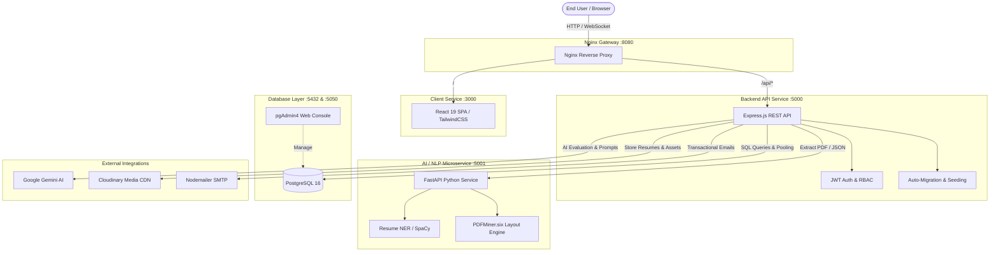

# IntelliHire 🚀

> **AI-Powered Recruitment, Intelligent CV Parsing & Automated Candidate Assessment Platform**

[](#quick-start-with-docker-compose)
[](#frontend-service)
[](#backend-api-service)
[](#nlp--cv-extraction-microservice)
[](#database--admin)
[](#ai-features)

---

## 📌 Overview

**IntelliHire** is an end-to-end intelligent recruitment and talent evaluation platform designed to bridge the gap between job seekers and hiring teams. It eliminates manual recruitment overhead by integrating automated CV parsing, deep layout-preserving PDF analysis, AI-driven candidate ranking, automated mock interviews, customized skill assessment tests, and role-based workflows for Candidates, Recruiters, Panelists, and Administrators.

---

## ✨ Key Features

### 🧑‍💻 Candidate Experience
- **Interactive Dashboard:** Real-time visibility into active applications, recruitment stages, upcoming interviews, and skill assessments.
- **AI-Powered CV Parsing:** Upload any PDF CV; the system extracts layout, contact information, social links (LinkedIn, GitHub), work history, education, and technical skills automatically.
- **CV Profile Management:** Maintain and switch between multiple active resumes, fine-tune extracted credentials, and manage personal portfolio profiles.
- **Job Discovery & 1-Click Application:** Search, filter, and apply for open vacancies with immediate feedback and application status tracking.
- **AI Mock Interview Simulator:** Practice domain-specific behavioral and technical interviews with AI-generated role questions, instant speech/text feedback, performance scoring, and historical analytics.
- **Technical Assessments:** Complete vacancy-linked timed tests and review comprehensive skill reports.
- **Community Forum:** Connect with peers, share interview tips, review company guidelines, and bookmark insightful discussions.

### 🏢 Recruiter Suite
- **Vacancy Lifecycle Management:** Create, preview, edit, publish, and close job vacancies with structured criteria, salary ranges, deadlines, and panelist allocations.
- **AI Candidate Ranking:** Automatically match and rank applicant pools against vacancy requirements using skill scoring algorithms.
- **Interview Scheduling & Time Slot Allocation:** Set up interview slots, allocate candidates to interviewers, reschedule slots, and notify participants automatically.
- **Assessment Builder & Question Bank:** Design custom skill tests with multiple-choice, short-answer, and coding problems; preview tests and inspect candidate submissions.
- **Comprehensive Analytics:** Track candidate funnel health, applicant demographics, shortlisting velocity, and assessment pass rates.
- **Subscription & Billing:** Flexible hiring packages with integrated payment flows, invoice history, and OTP verification.

### 👥 Interview Panelist Hub
- **Panel Interview Scheduling:** Dedicated agenda showing assigned candidate interviews, job requirements, CV previews, and structured feedback scoring.

### 🛡️ System Administration
- **Recruiter Verification (KYB):** Review and verify company registrations, websites, and business legitimacy before granting hiring privileges.
- **User Management:** Manage candidate and recruiter accounts, roles, access permissions, and account activation states.
- **Community Moderation:** Review reported posts, enforce community standards, and audit discussion feeds.
- **Platform Health & Audit Trails:** Monitor service uptime, audit system activity logs, and view platform transactions.

---

## 🏗️ System Architecture



---

## 🧰 Technology Stack

| Layer | Technologies |
|---|---|
| **Frontend** | React 19, React Router DOM v6, Tailwind CSS, Vanilla CSS Design System, Lucide Icons, Axios |
| **Backend API** | Node.js (CommonJS), Express.js 4.16+, pg (Node-Postgres), Multer, Cloudinary SDK, Nodemailer |
| **AI & NLP Engine** | Python 3.10+, FastAPI, Uvicorn, SpaCy 3.6 (`en_core_web_sm` + Custom Resume NER), PDFMiner.six, Google Gemini API (`@google/genai`) |
| **Database** | PostgreSQL 16 (with JSONB support for dynamic schemas), pgAdmin 4 |
| **Reverse Proxy & Routing** | Nginx Alpine (Unified routing on port 8080) |
| **Containerization** | Docker, Docker Compose |

---

## 📁 Repository Structure

```text
IntelliHire/Source-code/
├── backend/                  # Node.js / Express REST API
│   ├── src/
│   │   ├── config/           # Database pool, schema migrations & auto-seeding
│   │   ├── controllers/      # Auth, Vacancies, Candidates, CVs, Admin, Values
│   │   ├── middlewares/      # JWT authentication, role guards & Multer upload
│   │   ├── models/           # Postgres query abstractions (Candidates, Vacancies, Users)
│   │   ├── routes/           # Express route definitions
│   │   ├── services/         # NLP service client, email service, external APIs
│   │   ├── utils/            # Password hashing, response handlers, PDF parser
│   │   ├── app.js            # Express app configuration & middleware
│   │   └── server.js         # Server bootstrap & DB initialization
│   ├── Dockerfile.dev        # Development container for backend
│   └── package.json          # Backend npm dependencies
│
├── frontend/                 # React 19 Single Page Application
│   ├── public/               # HTML templates and static web assets
│   ├── src/
│   │   ├── components/       # Shared UI components (Sidebars, TopBar, Modals)
│   │   ├── pages/            # Candidate, Recruiter, Admin, Panel & Community views
│   │   ├── routes/           # React Router v6 setup & ProtectedRoute guards
│   │   ├── styles/           # CSS design tokens (TalentBridge Midnight/Gold theme)
│   │   ├── utils/            # Status badge mappers, formatters, API clients
│   │   └── App.js            # Main application component
│   ├── Dockerfile.dev        # Development container for frontend
│   └── package.json          # Frontend npm dependencies
│
├── nlp/                      # Python FastAPI NLP & CV Parsing Microservice
│   ├── models/               # Custom trained Resume NER models
│   ├── main.py               # FastAPI application, PDF layout engine & extractors
│   ├── train_ner.py          # SpaCy NER model training script
│   ├── training_data.py      # Resume entity recognition annotated dataset
│   ├── requirements.txt      # Python dependencies (FastAPI, SpaCy, PDFMiner)
│   └── Dockerfile            # Container configuration with SpaCy English model
│
├── nginx/                    # Nginx Reverse Proxy
│   ├── default.conf          # Route mapping (/ -> Client, /api -> Backend)
│   └── Dockerfile.dev        # Nginx container definition
│
├── docker-compose.yml        # Multi-container orchestration definition
└── system_design.md          # Comprehensive UI/UX Design System Specification
```

---

## ⚡ Quick Start with Docker Compose

The easiest way to run the entire IntelliHire ecosystem is using Docker Compose.

### 1. Prerequisites
- [Docker Desktop](https://www.docker.com/products/docker-desktop/) (v24+ recommended)
- Git

### 2. Clone and Setup Environment
Navigate to the source code folder:
```bash
cd d:/IntelliHire/Source-code
```

Verify or update environment configuration in `backend/.env`:
```env
POSTGRES_USER=intellihire
POSTGRES_PASSWORD=intellihire123
POSTGRES_DB=intellihire_db
PGUSER=intellihire
PGHOST=postgres
PGDATABASE=intellihire_db
PGPASSWORD=intellihire123
PGPORT=5432
JWT_SECRET=intellihire-dev-jwt-secret-2026-change-me
APP_URL=http://localhost:8080
GEMINI_API_KEY=<your-google-gemini-key>
```

### 3. Build and Launch Containers
```bash
docker compose up --build
```

To run in detached (background) mode:
```bash
docker compose up -d --build
```

### 4. Access the Application
Once the containers are healthy, open your browser:

| Service | URL | Notes |
|---|---|---|
| **IntelliHire Web App** | [http://localhost:8080](http://localhost:8080) | Routed via Nginx gateway |
| **Backend REST API** | [http://localhost:8080/api](http://localhost:8080/api) | Proxied through Nginx |
| **NLP Microservice Docs** | [http://localhost:5001/docs](http://localhost:5001/docs) | Interactive Swagger UI |
| **pgAdmin 4 Database UI** | [http://localhost:5050](http://localhost:5050) | PostgreSQL Management Console |

---

## 🔑 Default Accounts & Credentials

The database seeds essential administrator and test demo accounts automatically upon first launch:

| Role | Email | Password | Access Rights |
|---|---|---|---|
| **System Admin** | `admin@intellihire.com` | `IntelliHire@2026` | Full platform control, KYB verification, audit logs |
| **Demo Recruiter** | `recruiter@intellihire.com` | `Recruiter@2026` | Create vacancies, rank candidates, manage assessments |
| **Demo Candidate** | `candidate@intellihire.com` | `Candidate@2026` | Upload CV, apply to jobs, take mock interviews & tests |
| **pgAdmin 4** | `admin@admin.com` | `admin` | Connect to host `postgres`, DB `intellihire_db` |

---

## 🛠️ Manual / Local Development Setup

If you prefer to run services individually outside Docker:

### 1. PostgreSQL Database
Ensure a local PostgreSQL instance is running on port `5432`:
```sql
CREATE USER intellihire WITH PASSWORD 'intellihire123';
CREATE DATABASE intellihire_db OWNER intellihire;
```

### 2. NLP Microservice (Python)
```bash
cd nlp
python -m venv venv
# On Windows:
.\venv\Scripts\activate
# On Linux/macOS:
source venv/bin/activate

pip install -r requirements.txt
pip install https://github.com/explosion/spacy-models/releases/download/en_core_web_sm-3.6.0/en_core_web_sm-3.6.0.tar.gz

uvicorn main:app --host 0.0.0.0 --port 5001 --reload
```

### 3. Backend API (Node.js)
```bash
cd backend
npm install
npm run dev
# Server starts on port 5000 (accessible directly or through Nginx)
```

### 4. Frontend Application (React)
```bash
cd frontend
npm install
npm start
# React dev server starts on port 3000
```

---

## 📡 API & Microservice Overview

### Core Backend Endpoints (`/api/*`)
- **Authentication:** `POST /api/auth/signup`, `POST /api/auth/signin`, `GET /api/auth/me`, `POST /api/auth/verify-email`
- **CV Processing:** `POST /api/cv/upload` (multipart/form-data upload with multi-tier parsing pipeline)
- **Candidate Profiles:** `GET /api/candidates/me`, `PUT /api/candidates/me/profile`, `GET /api/candidates/cvs`
- **Vacancies:** `GET /api/vacancies`, `POST /api/vacancies`, `GET /api/vacancies/:id`, `PATCH /api/vacancies/:id/status`
- **Recruiter Approvals & Admin:** `GET /api/admin/recruiters/pending`, `POST /api/admin/recruiters/:id/approve`, `GET /api/admin/metrics`

### NLP Microservice Endpoints (`:5001`)
- **`POST /extract-pdf`**: End-to-end single-call PDF layout conversion and candidate extraction.
- **`POST /convert-to-json`**: Converts binary PDF into structured coordinate-aware visual JSON hierarchy.
- **`POST /extract-from-json`**: Extracts candidate entities, skills, and chronological timelines from layout JSON.
- **`POST /extract`**: Plain-text entity extraction using custom Resume NER.

---

## 🎨 Design System

IntelliHire adheres to the **TalentBridge Visual Language** (detailed in [`system_design.md`](./system_design.md)):
- **Primary:** Midnight Navy (`#16171F`)
- **Accent:** Signal Gold (`#F0B90B`)
- **Page Background:** Soft Slate (`#F6F6F8`)
- **Typography:** Inter (`sans-serif`)
- **Design Philosophy:** Minimalist enterprise SaaS, high-contrast dark chrome sidebars, pill-shaped primary actions, and strict status-color mappings.

---

## 🤝 Contributing

1. Create a feature branch: `git checkout -b feature/amazing-feature`
2. Commit your modifications: `git commit -m "Add amazing feature"`
3. Push to your branch: `git push origin feature/amazing-feature`
4. Open a Pull Request for review.

---

## 📄 License

This project is licensed under the ISC License. See project files for details.
